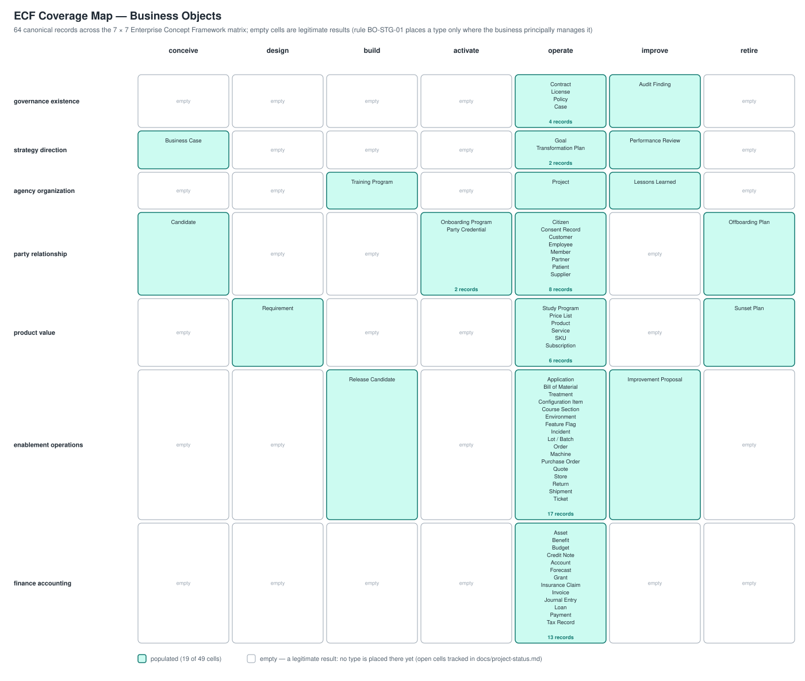

# OpenDEA Business Objects

The canonical catalog of **Business Objects** for the TechNeHub Labs Digital Enterprise Architecture (DEA) ecosystem.

A Business Object is a real-world entity the business cares about — a Customer, an Order, an Invoice, a Consent Record. This catalog is the authoritative register of those types: each is a versioned, content-addressed record with a precise classification, resolved references into the sibling catalogs, and full documentation.

**Layer:** L2 (Business Operating Model) · **Entity:** `BO` · **Metamodel:** [v1.0.0-alpha](https://github.com/technehub-labs/dea-metamodel)

[](https://technehub-labs.github.io/metamodel/?entity=BusinessObject)
[](https://github.com/technehub-labs/dea-catalog-business-objects/actions/workflows/ci.yml)
[](docs/project-status.md)
[](.github/workflows/)

## Why this catalog exists

The DEA ecosystem models an enterprise along two universal coordinates — **what** the business does (ECF domains) and **when** in the lifecycle it does it (ECF stages). Business Objects are the *atoms* that give those coordinates substance: capabilities act on them, processes create and update them, data entities persist them, and solution components realize them.

Without a canonical register of these types, every catalog and every model improvises its own vocabulary — one system's "client" is another's "account holder," and cross-referencing decays into string matching. This catalog fixes the vocabulary once: each type has one id, one classification, one ECF cell, and references that resolve mechanically.

**In the ecosystem, this is one of seven interoperable catalogs.** Business Objects sit at the center of the mesh: they are the join points the other catalogs reference.

## Positioning

| Concern | Document |
|---|---|
| What this is; why it exists; how it's built; how to use it | this README |
| Where the population stands; coverage; open threads | [docs/project-status.md](docs/project-status.md) |
| Rules, workflow, decision log | [docs/governance/catalog-governance.md](docs/governance/catalog-governance.md) |
| Versioning policy, release cuts | [docs/versioning.md](docs/versioning.md) |
| Change Request register | [change-requests/README.md](change-requests/README.md) |
| Notable changes | [CHANGELOG.md](CHANGELOG.md) |

## Architecture

### Record model

Every Business Object is one record at a flat, content-addressed path:

```
entities/v1-alpha/<slug>-<hash6>/
├── objects-object-<slug>-<hash6>.yaml   # the record (id, classification, references, lifecycle)
├── README.md                            # record documentation (IDM-007)
└── aspects.md                           # six-aspect deep-dive
```

- **Identity:** the id is `objects:object-<slug>-<hash6>`; the hash suffix is derived once, at admission, from the record content and is immutable thereafter. The filesystem path is the id with `:` normalized to `-`.
- **Classification:** two universal coordinates (`ecf_domain`, `ecf_stage`) place the record in the ECF matrix; two free-form labels (`object_class`, `object_subclass`) carry the domain vocabulary.
- **References:** cross-catalog references (`capabilities_consumed[]`, `processes_involved[]`, and the planned `owner[]`, `stakeholders[]`, `events[]`, `data_entities[]`) are typed, content-addressed ids that must resolve against the live sibling catalogs — unresolved references are forbidden.
- **Lifecycle:** `ecf_stage` (the universal coordinate) and `current_state` (the domain business label) are deliberately separate lifecycles; transitions are recorded in `state_history`.

## Classification

Business Objects are classified by **two universal coordinates plus two free-form labels**:

### Universal coordinates (ECF matrix position)

| Axis | Values |
|---|---|
| `ecf_domain` | `governance-existence` · `strategy-direction` · `agency-organization` · `party-relationship` · `product-value` · `enablement-operations` · `finance-accounting` |
| `ecf_stage` | `conceive` · `design` · `build` · `activate` · `operate` · `improve` · `retire` |

Every BO lives in exactly one `(ecf_domain, ecf_stage)` cell at a time.

### Free-form labels (domain-specific vocabulary)

| Axis | Purpose | Example |
|---|---|---|
| `object_class` | Kind of thing the business cares about | `customer`, `order`, `product`, `invoice`, `feature-flag`, `grant` |
| `object_subclass` | Refinement under the class | `retail-customer`, `enterprise-order` |

`current_state` is a **separate** domain-specific business label (e.g. `active`, `proposed`, `suspended`) — distinct from the universal `ecf_stage` coordinate.

### Classes in use today

| `object_class` | Records | Subclasses |
|---|---|---|
| `party` | 9 | `customer`, `supplier`, `employee`, `partner`, `patient`, `citizen`, `member`, `candidate-party`, `subscriber` |
| `transaction` | 13 | `sales-order`, `sales-quote`, `shipment`, `return-rma`, `purchase-order`, `service-ticket`, `insurance-claim`, `care-encounter`, `public-case`, `course-section`, `requirement`, `service-instance`, `usage-record` |
| `offering` | 7 | `catalogue-product`, `service`, `subscription-plan`, `price-list`, `education-program`, `stock-keeping-unit`, `tariff-plan` |
| `financial-instrument` | 13 | `billing-invoice`, `customer-payment`, `disbursement-grant`, `journal-entry`, `budget`, `credit-note`, `fixed-asset`, `loan`, `deposit-account`, `benefit-entitlement`, `forecast`, `tax-record`, `prepaid-balance` |
| `legal-instrument` | 5 | `commercial-contract`, `license`, `policy`, `consent-record`, `interconnect-agreement` |
| `technology-control` | 8 | `release-feature-flag`, `application`, `environment`, `service-incident`, `release-candidate`, `party-credential`, `configuration-item`, `subscriber-identity-module` |
| `work-item` | 12 | `project`, `strategic-goal`, `business-case`, `offboarding-plan`, `sunset-plan`, `training-program`, `onboarding-program`, `transformation-plan`, `audit-finding`, `performance-review`, `improvement-proposal`, `lessons-learned` |
| `resource` | 5 | `manufacturing-lot`, `bill-of-material`, `production-machine`, `network-asset`, `service-number` |
| `location` | 2 | `retail-store`, `coverage-area` |

Industry and segment variation is expressed at the subclass level (rule **BO-TAX-01**); new `object_class` values require CR-level sign-off. Aspects prose carries an explicit sector lens. Rules and their decisions: [catalog governance](docs/governance/catalog-governance.md).

## Entity definition

| Field | Value |
|-------|-------|
| Entity ID | `dea:entity-business-object` |
| Class Alias | `BO` |
| Layer | L2 (Business Operating Model) |
| Metamodel Version | v1.0.0-alpha |

## Typed references

| Field | Reference | Catalog |
|---|---|---|
| `owner` | Actor (single) | [`dea-catalog-actors`](https://github.com/technehub-labs/dea-catalog-actors) |
| `stakeholders[]` | External/affected parties | [`dea-catalog-stakeholders`](https://github.com/technehub-labs/dea-catalog-stakeholders) |
| `capabilities_consumed[]` | Capabilities that act on this BO | [`dea-catalog-business-capabilities`](https://github.com/technehub-labs/dea-catalog-business-capabilities) |
| `processes_involved[]` | Processes that create/read/update/delete this BO | [`dea-catalog-business-processes`](https://github.com/technehub-labs/dea-catalog-business-processes) |
| `data_entities[]` | Data entities persisting this BO | data catalog (unbound) |
| `components_realizing[]` | Solution Components that realize this BO | [`dea-catalog-digital-business-service-factory`](https://github.com/technehub-labs/dea-catalog-digital-business-service-factory) |
| `events[]` | Business events this BO participates in | events catalog (unbound) |

A reference is populated only when it resolves against the live sibling catalog at landing time; until a sibling catalog binds, the field stays empty (IDM-003 — no unresolved references, ever).


## Identity

Records are **content-addressed**: the id hash suffix was assigned once, at admission, from the record content (first 4 bytes of the file's SHA-256, base-31 over the alphabet `a-z` minus `i`, `l`, `o` plus digits `2-9`) and is immutable thereafter. The filesystem path is the id with `:` normalized to `-` (IDM-005).

```yaml
id: objects:object-customer-2qvphc      # namespace:level-slug-hash6
identity:                              # instance-level identity (planned)
  primary_id: customer-12345            # canonical handle
  external_ids:                         # source-system mapping
    crm_id: SF-0034Q00012
    erp_id: SAP-DEBI-9001
```

See [`dea-metaframework/docs/id-system.md`](https://github.com/technehub-labs/dea-metaframework/blob/main/docs/id-system.md) §2.5 for the org-wide id contract.


### Catalog mesh

The taxonomy, at a glance ([source](docs/diagrams/catalog-taxonomy-mindmap.puml)):

![Catalog taxonomy](https://www.plantuml.com/plantuml/svg/NLLBhjiu4Dpx50IoSGmGy4UofG01OdsypG42uu6csZRpA5BXnubpW1mWbvdz76LECarIUdQoigLkDgkhgrgVh6F6zK9rFHi8Puv9VQ6E_T1Az_VPuikxTRrfy-MHl2mMUR5OaCfReS1Qyldq5RYpBxF5ukNBkzLXUwZMHp9WkJkP5-yn7oEBHuHxwtGF9htTP6NHL4TY_J180ORy-m-1Vf3w3X3-XpfgIiwRVTF6uaw0SY7EXHC_GOM_FVIdARF8wrLRucLCTQ9Z3cW4D69iYop3e3DCMSQTq8hCLwidg6E2PH8i_UQrYrZIepRTTCkwhUlT2lEkOkX7G0QSDugQdesOYsPRD8ZP6tvb5jBvM0xCJN2WJl1NS2FkTRlSxuzOvPiN1aBH5DXNRLLlZqGewn4s7kEIYJvIm0nGK5nxvLBbmP-au9JZTJ51UuCNMuYj9WwgNPalaNTzFeCHwaBcsqV_Kt3KWKVsZEuyTq-mKsQJxUjb4yPtijo88Ln01ydYG0OJsfF2ZZqSLdMsF1m9O2cMCes-61QxG57mL_eAC20QwfLm2MYPRLPhRFmi5BOjcAH8WJC-yZrVhH-efyoJa3BK4Egc4K1aODGSgk3-uBIkiiqcFvAlo8_2mXWmzv1-yjq5OhDdRG1f70-qzMwvtI0l1ZhXg1frSHO_eAFCsdG6NKFn5CvvQhlC2fnf9-mf3280eDXsqelKYQmE1csnAEDna146A3ZZAymNJavYG4wszIOh48U4orzyP0ywfYIkU-myCiSrTiZI654WeEmungBDidqGgSRNzwGP32BEjqQ2RxBYiDiToNTjNgbmq9FvxiaqOnHd6XP2cgb1wrrGYXVDP68sROsepV7SRfyNoOr2XRazYKAhasQcUtgRpcHvjIcRgDv7mgWwwn6vYuy9zdwPBPUukHpmgzAevtiYGii_H3-b6P0GV7e6Xax6NyakeIuB2ohfTfJFVdjOjIXdTHD6gsa1JBOMgDRkJMjjLHPP-wZ-jfYc9OUWK5LXr4mct7cpRNRnY4M1ef3dcmVQATWpvSyuKXzCJALEma47K7scFTOt8Z4_EZYuhcVyYbFuynQfKs_egITEgcfTbG62Oq9ID9616MVHvXz8INJS_I-uYb3yDboJ5oH9nYOLIMs2jDsLV2IiwuMruOxlx8RjO1gG_txzngNMeK7HU-41lqGNe0h1tE3zx1FW9obzbcR_0m00)

### Coverage across the ECF matrix

Every Business Object occupies exactly one cell of the Enterprise Concept Framework — the intersection of an **ECF domain** (what the business does) and an **ECF stage** (where in the lifecycle the business principally manages the type). 
The map below shows all 74 records in their cells: the density of the `operate` column reflects reality, most types are managed in steady state， while the sparse outer cells hold the *stage-native* types that exist only in a lifecycle moment (a Business Case is consumed at the decision; a Sunset Plan exists only at the offering's exit). 
Empty cells are legitimate results, not gaps: a type is placed only where the business principally manages it (rule BO-STG-01), and the deliberately-open cells are tracked in [project status](docs/project-status.md).



The poster source is [`visuals/ecf-coverage-map.svg`](visuals/ecf-coverage-map.svg) — regenerate it from the records when the population changes (the sibling catalogs carry equivalent maps: `dea-catalog-business-capabilities/visuals/v09-ecf-coverage-map.svg`).

## Usage

### Finding a Business Object

The full register, one row per record:

| Business Object | id | Class | ECF cell | Consumed by (capabilities) | Involved in (processes) | Sector lens |
|---|---|---|---|---|---|---|
| [Application](entities/v1-alpha/application-eewde8/README.md) | `objects:object-application-eewde8` | technology-control / application | enablement-operations · operate | technology-management, technology-enablement | eo-operate |  |
| [Asset](entities/v1-alpha/asset-w887xr/README.md) | `objects:object-asset-w887xr` | financial-instrument / fixed-asset | finance-accounting · operate | asset-management, financial-resource-management | eo-operate |  |
| [Audit Finding](entities/v1-alpha/audit-finding-jd44zy/README.md) | `objects:object-audit-finding-jd44zy` | work-item / audit-finding | governance-existence · improve | enterprise-governance | ge-improve |  |
| [Benefit](entities/v1-alpha/benefit-entitlement-yx4ckm/README.md) | `objects:object-benefit-entitlement-yx4ckm` | financial-instrument / benefit-entitlement | finance-accounting · operate | financial-stewardship | fa-operate | *government* |
| [Bill of Material](entities/v1-alpha/bill-of-material-9skzte/README.md) | `objects:object-bill-of-material-9skzte` | resource / bill-of-material | enablement-operations · operate | operations-management | eo-operate | *manufacturing* |
| [Budget](entities/v1-alpha/budget-h77u8h/README.md) | `objects:object-budget-h77u8h` | financial-instrument / budget | finance-accounting · operate | financial-resource-management, financial-stewardship | fa-operate |  |
| [Business Case](entities/v1-alpha/business-case-et8p4e/README.md) | `objects:object-business-case-et8p4e` | work-item / business-case | strategy-direction · conceive | strategic-planning | sd-conceive |  |
| [Candidate](entities/v1-alpha/candidate-party-s8q2mk/README.md) | `objects:object-candidate-party-s8q2mk` | party / candidate-party | party-relationship · conceive | customer-management | pr-conceive |  |
| [Treatment](entities/v1-alpha/care-encounter-8enzdc/README.md) | `objects:object-care-encounter-8enzdc` | transaction / care-encounter | enablement-operations · operate | operations-management | eo-operate | *healthcare* |
| [Citizen](entities/v1-alpha/citizen-2xqsse/README.md) | `objects:object-citizen-2xqsse` | party / citizen | party-relationship · operate | customer-management | — | *government* |
| [Configuration Item](entities/v1-alpha/configuration-item-tsn3ex/README.md) | `objects:object-configuration-item-tsn3ex` | technology-control / configuration-item | enablement-operations · operate | technology-management, security-management | eo-operate |  |
| [Consent Record](entities/v1-alpha/consent-record-gacq7d/README.md) | `objects:object-consent-record-gacq7d` | legal-instrument / consent-record | party-relationship · operate | customer-management, information-management | — |  |
| [Contract](entities/v1-alpha/contract-w24y9z/README.md) | `objects:object-contract-w24y9z` | legal-instrument / commercial-contract | governance-existence · operate | legal-matter-management | — |  |
| [Course Section](entities/v1-alpha/course-section-j4fdpq/README.md) | `objects:object-course-section-j4fdpq` | transaction / course-section | enablement-operations · operate | operations-management | eo-operate | *education* |
| [Coverage Area](entities/v1-alpha/coverage-area-vf8sfv/README.md) | `objects:object-coverage-area-vf8sfv` | location / coverage-area | enablement-operations · operate | regulation-management, operations-management | eo-operate | *telecom* |
| [Credit Note](entities/v1-alpha/credit-note-k6nktp/README.md) | `objects:object-credit-note-k6nktp` | financial-instrument / credit-note | finance-accounting · operate | financial-resource-management | fa-operate |  |
| [Customer](entities/v1-alpha/customer-2qvphc/README.md) | `objects:object-customer-2qvphc` | party / customer | party-relationship · operate | customer-management | pr-conceive, pr-operate |  |
| [Account](entities/v1-alpha/deposit-account-u6hdbe/README.md) | `objects:object-deposit-account-u6hdbe` | financial-instrument / deposit-account | finance-accounting · operate | financial-resource-management | fa-operate | *banking* |
| [Study Program](entities/v1-alpha/education-program-n6mp9m/README.md) | `objects:object-education-program-n6mp9m` | offering / education-program | product-value · operate | offering-management | pv-improve, pv-operate | *education* |
| [Employee](entities/v1-alpha/employee-phbzym/README.md) | `objects:object-employee-phbzym` | party / employee | party-relationship · operate | workforce-management | ao-operate, fa-operate |  |
| [Environment](entities/v1-alpha/environment-npd5vt/README.md) | `objects:object-environment-npd5vt` | technology-control / environment | enablement-operations · operate | technology-management, technology-enablement | eo-operate |  |
| [Feature Flag](entities/v1-alpha/feature-flag-p5gzf7/README.md) | `objects:object-feature-flag-p5gzf7` | technology-control / release-feature-flag | enablement-operations · operate | technology-enablement, technology-management | — |  |
| [Forecast](entities/v1-alpha/forecast-um3az3/README.md) | `objects:object-forecast-um3az3` | financial-instrument / forecast | finance-accounting · operate | financial-resource-management, enterprise-performance-management | fa-build, fa-operate |  |
| [Goal](entities/v1-alpha/goal-h2zfhv/README.md) | `objects:object-goal-h2zfhv` | work-item / strategic-goal | strategy-direction · operate | strategic-planning, enterprise-performance-management | sd-operate |  |
| [Grant](entities/v1-alpha/grant-nhdwg9/README.md) | `objects:object-grant-nhdwg9` | financial-instrument / disbursement-grant | finance-accounting · operate | financial-stewardship | — |  |
| [Improvement Proposal](entities/v1-alpha/improvement-proposal-cwcz6m/README.md) | `objects:object-improvement-proposal-cwcz6m` | work-item / improvement-proposal | enablement-operations · improve | idea-management, insight-management, operations-management | eo-improve, fa-improve |  |
| [Incident](entities/v1-alpha/incident-wudf9s/README.md) | `objects:object-incident-wudf9s` | technology-control / service-incident | enablement-operations · operate | technology-management, continuity-management | eo-operate |  |
| [Insurance Claim](entities/v1-alpha/insurance-claim-g5mag3/README.md) | `objects:object-insurance-claim-g5mag3` | transaction / insurance-claim | finance-accounting · operate | financial-resource-management | fa-operate | *insurance* |
| [Interconnect Agreement](entities/v1-alpha/interconnect-agreement-dvq2ce/README.md) | `objects:object-interconnect-agreement-dvq2ce` | legal-instrument / interconnect-agreement | governance-existence · operate | legal-matter-management, partner-management | eo-operate | *telecom* |
| [Invoice](entities/v1-alpha/invoice-z3fwgb/README.md) | `objects:object-invoice-z3fwgb` | financial-instrument / billing-invoice | finance-accounting · operate | financial-resource-management, financial-stewardship | — |  |
| [Journal Entry](entities/v1-alpha/journal-entry-khck7r/README.md) | `objects:object-journal-entry-khck7r` | financial-instrument / journal-entry | finance-accounting · operate | financial-resource-management | fa-operate |  |
| [Lessons Learned](entities/v1-alpha/lessons-learned-pvcj26/README.md) | `objects:object-lessons-learned-pvcj26` | work-item / lessons-learned | agency-organization · improve | enterprise-performance-management, change-management | ao-improve |  |
| [License](entities/v1-alpha/license-na3j53/README.md) | `objects:object-license-na3j53` | legal-instrument / license | governance-existence · operate | legal-matter-management, regulation-management | — |  |
| [Loan](entities/v1-alpha/loan-byjy28/README.md) | `objects:object-loan-byjy28` | financial-instrument / loan | finance-accounting · operate | financial-resource-management, risk-management | fa-operate | *banking* |
| [Lot / Batch](entities/v1-alpha/manufacturing-lot-pkbqev/README.md) | `objects:object-manufacturing-lot-pkbqev` | resource / manufacturing-lot | enablement-operations · operate | operations-management | eo-operate | *manufacturing* |
| [Member](entities/v1-alpha/member-vbxqke/README.md) | `objects:object-member-vbxqke` | party / member | party-relationship · operate | customer-management | pr-improve | *non-profit* |
| [Network Asset](entities/v1-alpha/network-asset-wee4fw/README.md) | `objects:object-network-asset-wee4fw` | resource / network-asset | enablement-operations · operate | asset-management, operations-management | eo-improve, eo-operate | *telecom* |
| [Offboarding Plan](entities/v1-alpha/offboarding-plan-djz4md/README.md) | `objects:object-offboarding-plan-djz4md` | work-item / offboarding-plan | party-relationship · retire | customer-management | pr-retire |  |
| [Onboarding Program](entities/v1-alpha/onboarding-program-mrun5r/README.md) | `objects:object-onboarding-program-mrun5r` | work-item / onboarding-program | party-relationship · activate | customer-management | pr-activate |  |
| [Order](entities/v1-alpha/order-bpy4g4/README.md) | `objects:object-order-bpy4g4` | transaction / sales-order | enablement-operations · operate | operations-management | eo-operate |  |
| [Partner](entities/v1-alpha/partner-cfhqx9/README.md) | `objects:object-partner-cfhqx9` | party / partner | party-relationship · operate | partner-management | — |  |
| [Party Credential](entities/v1-alpha/party-credential-kaqfq8/README.md) | `objects:object-party-credential-kaqfq8` | technology-control / party-credential | party-relationship · activate | security-management, information-management | pr-activate |  |
| [Patient](entities/v1-alpha/patient-w8ry62/README.md) | `objects:object-patient-w8ry62` | party / patient | party-relationship · operate | customer-management | eo-operate | *healthcare* |
| [Payment](entities/v1-alpha/payment-kgsvrg/README.md) | `objects:object-payment-kgsvrg` | financial-instrument / customer-payment | finance-accounting · operate | financial-resource-management | — |  |
| [Performance Review](entities/v1-alpha/performance-review-k3k7n6/README.md) | `objects:object-performance-review-k3k7n6` | work-item / performance-review | strategy-direction · improve | enterprise-performance-management, strategic-planning | eo-improve, pv-improve, sd-improve |  |
| [Policy](entities/v1-alpha/policy-nd2t4y/README.md) | `objects:object-policy-nd2t4y` | legal-instrument / policy | governance-existence · operate | enterprise-governance, regulation-management | ge-operate |  |
| [Prepaid Balance](entities/v1-alpha/prepaid-balance-k65673/README.md) | `objects:object-prepaid-balance-k65673` | financial-instrument / prepaid-balance | finance-accounting · operate | financial-resource-management | fa-operate | *telecom* |
| [Price List](entities/v1-alpha/price-list-4bk48j/README.md) | `objects:object-price-list-4bk48j` | offering / price-list | product-value · operate | offering-management, marketing | pv-operate |  |
| [Product](entities/v1-alpha/product-dkf9gb/README.md) | `objects:object-product-dkf9gb` | offering / catalogue-product | product-value · operate | offering-management, marketing | pv-design, pv-operate |  |
| [Machine](entities/v1-alpha/production-machine-j5z9kv/README.md) | `objects:object-production-machine-j5z9kv` | resource / production-machine | enablement-operations · operate | asset-management, operations-management | eo-operate | *manufacturing* |
| [Project](entities/v1-alpha/project-5hgzd3/README.md) | `objects:object-project-5hgzd3` | work-item / project | agency-organization · operate | enterprise-performance-management, strategic-planning | sd-operate |  |
| [Case](entities/v1-alpha/public-case-ae4yg8/README.md) | `objects:object-public-case-ae4yg8` | transaction / public-case | governance-existence · operate | legal-matter-management | ge-operate | *government* |
| [Purchase Order](entities/v1-alpha/purchase-order-qf4tfa/README.md) | `objects:object-purchase-order-qf4tfa` | transaction / purchase-order | enablement-operations · operate | sourcing-and-procurement | eo-operate, fa-operate |  |
| [Quote](entities/v1-alpha/quote-gnngfe/README.md) | `objects:object-quote-gnngfe` | transaction / sales-quote | enablement-operations · operate | operations-management | eo-operate |  |
| [Release Candidate](entities/v1-alpha/release-candidate-wed4tk/README.md) | `objects:object-release-candidate-wed4tk` | technology-control / release-candidate | enablement-operations · build | technology-management, technology-enablement | eo-build |  |
| [Requirement](entities/v1-alpha/requirement-9ukadu/README.md) | `objects:object-requirement-9ukadu` | transaction / requirement | product-value · design | offering-management, technology-management | pv-design |  |
| [Store](entities/v1-alpha/retail-store-6kzkfj/README.md) | `objects:object-retail-store-6kzkfj` | location / retail-store | enablement-operations · operate | operations-management, facility-management | eo-operate | *retail* |
| [Return](entities/v1-alpha/return-uwz79t/README.md) | `objects:object-return-uwz79t` | transaction / return-rma | enablement-operations · operate | operations-management | eo-operate |  |
| [Service Instance](entities/v1-alpha/service-instance-j5uxmb/README.md) | `objects:object-service-instance-j5uxmb` | transaction / service-instance | enablement-operations · operate | operations-management | eo-operate, pv-activate | *telecom* |
| [Service Number](entities/v1-alpha/service-number-6axyb2/README.md) | `objects:object-service-number-6axyb2` | resource / service-number | governance-existence · operate | regulation-management, information-management | ge-operate | *telecom* |
| [Service](entities/v1-alpha/service-q8w4ce/README.md) | `objects:object-service-q8w4ce` | offering / service | product-value · operate | offering-management | pv-operate |  |
| [Shipment](entities/v1-alpha/shipment-mb7wgn/README.md) | `objects:object-shipment-mb7wgn` | transaction / shipment | enablement-operations · operate | operations-management | eo-operate |  |
| [SIM Profile](entities/v1-alpha/sim-profile-ja8k4x/README.md) | `objects:object-sim-profile-ja8k4x` | technology-control / subscriber-identity-module | party-relationship · activate | security-management, technology-management | pr-activate | *telecom* |
| [SKU](entities/v1-alpha/stock-keeping-unit-x6rq8r/README.md) | `objects:object-stock-keeping-unit-x6rq8r` | offering / stock-keeping-unit | product-value · operate | offering-management, operations-management | eo-operate, pv-operate | *retail* |
| [Subscriber](entities/v1-alpha/subscriber-muj94k/README.md) | `objects:object-subscriber-muj94k` | party / subscriber | party-relationship · operate | customer-management | pr-activate, pr-operate | *telecom* |
| [Subscription](entities/v1-alpha/subscription-3v98yb/README.md) | `objects:object-subscription-3v98yb` | offering / subscription-plan | product-value · operate | offering-management | pv-operate |  |
| [Sunset Plan](entities/v1-alpha/sunset-plan-34225t/README.md) | `objects:object-sunset-plan-34225t` | work-item / sunset-plan | product-value · retire | offering-management | pv-retire |  |
| [Supplier](entities/v1-alpha/supplier-g7m7fu/README.md) | `objects:object-supplier-g7m7fu` | party / supplier | party-relationship · operate | supplier-management, sourcing-and-procurement | eo-operate, fa-operate |  |
| [Tariff Plan](entities/v1-alpha/tariff-plan-ah5q9f/README.md) | `objects:object-tariff-plan-ah5q9f` | offering / tariff-plan | product-value · operate | offering-management, regulation-management | pv-operate | *telecom* |
| [Tax Record](entities/v1-alpha/tax-record-zwqfpa/README.md) | `objects:object-tax-record-zwqfpa` | financial-instrument / tax-record | finance-accounting · operate | financial-resource-management, regulation-management | fa-design, fa-operate |  |
| [Ticket](entities/v1-alpha/ticket-2cudww/README.md) | `objects:object-ticket-2cudww` | transaction / service-ticket | enablement-operations · operate | operations-management | eo-operate |  |
| [Training Program](entities/v1-alpha/training-program-r8fpt3/README.md) | `objects:object-training-program-r8fpt3` | work-item / training-program | agency-organization · build | workforce-management, workforce-planning | ao-build |  |
| [Transformation Plan](entities/v1-alpha/transformation-plan-mpsz65/README.md) | `objects:object-transformation-plan-mpsz65` | work-item / transformation-plan | strategy-direction · operate | strategic-planning, enterprise-performance-management | sd-build, sd-operate |  |
| [Usage Record](entities/v1-alpha/usage-record-nax3b6/README.md) | `objects:object-usage-record-nax3b6` | transaction / usage-record | finance-accounting · operate | operations-management, financial-resource-management | eo-operate, fa-operate | *telecom* |

## Entity definition

| Field | Value |
|-------|-------|
| Entity ID | `dea:entity-business-object` |
| Class Alias | `BO` |
| Layer | L2 (Business Operating Model) |
| Metamodel Version | v1.0.0-alpha |

## Typed references

| Field | Reference | Catalog |
|---|---|---|
| `owner` | Actor (single) | [`dea-catalog-actors`](https://github.com/technehub-labs/dea-catalog-actors) |
| `stakeholders[]` | External/affected parties | [`dea-catalog-stakeholders`](https://github.com/technehub-labs/dea-catalog-stakeholders) |
| `capabilities_consumed[]` | Capabilities that act on this BO | [`dea-catalog-business-capabilities`](https://github.com/technehub-labs/dea-catalog-business-capabilities) |
| `processes_involved[]` | Processes that create/read/update/delete this BO | [`dea-catalog-business-processes`](https://github.com/technehub-labs/dea-catalog-business-processes) |
| `data_entities[]` | Data entities persisting this BO | data catalog (unbound) |
| `components_realizing[]` | Solution Components that realize this BO | [`dea-catalog-digital-business-service-factory`](https://github.com/technehub-labs/dea-catalog-digital-business-service-factory) |
| `events[]` | Business events this BO participates in | events catalog (unbound) |

A reference is populated only when it resolves against the live sibling catalog at landing time; until a sibling catalog binds, the field stays empty (IDM-003 — no unresolved references, ever).


## Identity

Records are **content-addressed**: the id hash suffix was assigned once, at admission, from the record content (first 4 bytes of the file's SHA-256, base-31 over the alphabet `a-z` minus `i`, `l`, `o` plus digits `2-9`) and is immutable thereafter. The filesystem path is the id with `:` normalized to `-` (IDM-005).

```yaml
id: objects:object-customer-2qvphc      # namespace:level-slug-hash6
identity:                              # instance-level identity (planned)
  primary_id: customer-12345            # canonical handle
  external_ids:                         # source-system mapping
    crm_id: SF-0034Q00012
    erp_id: SAP-DEBI-9001
```

See [`dea-metaframework/docs/id-system.md`](https://github.com/technehub-labs/dea-metaframework/blob/main/docs/id-system.md) §2.5 for the org-wide id contract.


### Catalog mesh

The taxonomy, at a glance ([source](docs/diagrams/catalog-taxonomy-mindmap.puml)):

![Catalog taxonomy](https://www.plantuml.com/plantuml/svg/NLLBhjiu4Dpx50IoSGmGy4UofG01OdsypG42uu6csZRpA5BXnubpW1mWbvdz76LECarIUdQoigLkDgkhgrgVh6F6zK9rFHi8Puv9VQ6E_T1Az_VPuikxTRrfy-MHl2mMUR5OaCfReS1Qyldq5RYpBxF5ukNBkzLXUwZMHp9WkJkP5-yn7oEBHuHxwtGF9htTP6NHL4TY_J180ORy-m-1Vf3w3X3-XpfgIiwRVTF6uaw0SY7EXHC_GOM_FVIdARF8wrLRucLCTQ9Z3cW4D69iYop3e3DCMSQTq8hCLwidg6E2PH8i_UQrYrZIepRTTCkwhUlT2lEkOkX7G0QSDugQdesOYsPRD8ZP6tvb5jBvM0xCJN2WJl1NS2FkTRlSxuzOvPiN1aBH5DXNRLLlZqGewn4s7kEIYJvIm0nGK5nxvLBbmP-au9JZTJ51UuCNMuYj9WwgNPalaNTzFeCHwaBcsqV_Kt3KWKVsZEuyTq-mKsQJxUjb4yPtijo88Ln01ydYG0OJsfF2ZZqSLdMsF1m9O2cMCes-61QxG57mL_eAC20QwfLm2MYPRLPhRFmi5BOjcAH8WJC-yZrVhH-efyoJa3BK4Egc4K1aODGSgk3-uBIkiiqcFvAlo8_2mXWmzv1-yjq5OhDdRG1f70-qzMwvtI0l1ZhXg1frSHO_eAFCsdG6NKFn5CvvQhlC2fnf9-mf3280eDXsqelKYQmE1csnAEDna146A3ZZAymNJavYG4wszIOh48U4orzyP0ywfYIkU-myCiSrTiZI654WeEmungBDidqGgSRNzwGP32BEjqQ2RxBYiDiToNTjNgbmq9FvxiaqOnHd6XP2cgb1wrrGYXVDP68sROsepV7SRfyNoOr2XRazYKAhasQcUtgRpcHvjIcRgDv7mgWwwn6vYuy9zdwPBPUukHpmgzAevtiYGii_H3-b6P0GV7e6Xax6NyakeIuB2ohfTfJFVdjOjIXdTHD6gsa1JBOMgDRkJMjjLHPP-wZ-jfYc9OUWK5LXr4mct7cpRNRnY4M1ef3dcmVQATWpvSyuKXzCJALEma47K7scFTOt8Z4_EZYuhcVyYbFuynQfKs_egITEgcfTbG62Oq9ID9616MVHvXz8INJS_I-uYb3yDboJ5oH9nYOLIMs2jDsLV2IiwuMruOxlx8RjO1gG_txzngNMeK7HU-41lqGNe0h1tE3zx1FW9obzbcR_0m00)

### Coverage across the ECF matrix

Every Business Object occupies exactly one cell of the Enterprise Concept Framework — the intersection of an **ECF domain** (what the business does) and an **ECF stage** (where in the lifecycle the business principally manages the type). 
The map below shows all 74 records in their cells: the density of the `operate` column reflects reality, most types are managed in steady state， while the sparse outer cells hold the *stage-native* types that exist only in a lifecycle moment (a Business Case is consumed at the decision; a Sunset Plan exists only at the offering's exit). 
Empty cells are legitimate results, not gaps: a type is placed only where the business principally manages it (rule BO-STG-01), and the deliberately-open cells are tracked in [project status](docs/project-status.md).


The poster source is [`visuals/ecf-coverage-map.svg`](visuals/ecf-coverage-map.svg) — regenerate it from the records when the population changes (the sibling catalogs carry equivalent maps: `dea-catalog-business-capabilities/visuals/v09-ecf-coverage-map.svg`).

## Usage

### Finding a Business Object

The full register, one row per record:

| Business Object | id | Class | ECF cell | Consumed by (capabilities) | Involved in (processes) | Sector lens |
|---|---|---|---|---|---|---|
| [Application](entities/v1-alpha/application-eewde8/README.md) | `objects:object-application-eewde8` | technology-control / application | enablement-operations · operate | technology-management, technology-enablement | eo-operate |  |
| [Asset](entities/v1-alpha/asset-w887xr/README.md) | `objects:object-asset-w887xr` | financial-instrument / fixed-asset | finance-accounting · operate | asset-management, financial-resource-management | eo-operate |  |
| [Audit Finding](entities/v1-alpha/audit-finding-jd44zy/README.md) | `objects:object-audit-finding-jd44zy` | work-item / audit-finding | governance-existence · improve | enterprise-governance | ge-improve |  |
| [Benefit](entities/v1-alpha/benefit-entitlement-yx4ckm/README.md) | `objects:object-benefit-entitlement-yx4ckm` | financial-instrument / benefit-entitlement | finance-accounting · operate | financial-stewardship | fa-operate | *government* |
| [Bill of Material](entities/v1-alpha/bill-of-material-9skzte/README.md) | `objects:object-bill-of-material-9skzte` | resource / bill-of-material | enablement-operations · operate | operations-management | eo-operate | *manufacturing* |
| [Budget](entities/v1-alpha/budget-h77u8h/README.md) | `objects:object-budget-h77u8h` | financial-instrument / budget | finance-accounting · operate | financial-resource-management, financial-stewardship | fa-operate |  |
| [Business Case](entities/v1-alpha/business-case-et8p4e/README.md) | `objects:object-business-case-et8p4e` | work-item / business-case | strategy-direction · conceive | strategic-planning | sd-conceive |  |
| [Candidate](entities/v1-alpha/candidate-party-s8q2mk/README.md) | `objects:object-candidate-party-s8q2mk` | party / candidate-party | party-relationship · conceive | customer-management | pr-conceive |  |
| [Treatment](entities/v1-alpha/care-encounter-8enzdc/README.md) | `objects:object-care-encounter-8enzdc` | transaction / care-encounter | enablement-operations · operate | operations-management | eo-operate | *healthcare* |
| [Citizen](entities/v1-alpha/citizen-2xqsse/README.md) | `objects:object-citizen-2xqsse` | party / citizen | party-relationship · operate | customer-management | — | *government* |
| [Configuration Item](entities/v1-alpha/configuration-item-tsn3ex/README.md) | `objects:object-configuration-item-tsn3ex` | technology-control / configuration-item | enablement-operations · operate | technology-management, security-management | eo-operate |  |
| [Consent Record](entities/v1-alpha/consent-record-gacq7d/README.md) | `objects:object-consent-record-gacq7d` | legal-instrument / consent-record | party-relationship · operate | customer-management, information-management | — |  |
| [Contract](entities/v1-alpha/contract-w24y9z/README.md) | `objects:object-contract-w24y9z` | legal-instrument / commercial-contract | governance-existence · operate | legal-matter-management | — |  |
| [Course Section](entities/v1-alpha/course-section-j4fdpq/README.md) | `objects:object-course-section-j4fdpq` | transaction / course-section | enablement-operations · operate | operations-management | eo-operate | *education* |
| [Credit Note](entities/v1-alpha/credit-note-k6nktp/README.md) | `objects:object-credit-note-k6nktp` | financial-instrument / credit-note | finance-accounting · operate | financial-resource-management | fa-operate |  |
| [Customer](entities/v1-alpha/customer-2qvphc/README.md) | `objects:object-customer-2qvphc` | party / customer | party-relationship · operate | customer-management | pr-conceive, pr-operate |  |
| [Account](entities/v1-alpha/deposit-account-u6hdbe/README.md) | `objects:object-deposit-account-u6hdbe` | financial-instrument / deposit-account | finance-accounting · operate | financial-resource-management | fa-operate | *banking* |
| [Study Program](entities/v1-alpha/education-program-n6mp9m/README.md) | `objects:object-education-program-n6mp9m` | offering / education-program | product-value · operate | offering-management | pv-improve, pv-operate | *education* |
| [Employee](entities/v1-alpha/employee-phbzym/README.md) | `objects:object-employee-phbzym` | party / employee | party-relationship · operate | workforce-management | ao-operate, fa-operate |  |
| [Environment](entities/v1-alpha/environment-npd5vt/README.md) | `objects:object-environment-npd5vt` | technology-control / environment | enablement-operations · operate | technology-management, technology-enablement | eo-operate |  |
| [Feature Flag](entities/v1-alpha/feature-flag-p5gzf7/README.md) | `objects:object-feature-flag-p5gzf7` | technology-control / release-feature-flag | enablement-operations · operate | technology-enablement, technology-management | — |  |
| [Forecast](entities/v1-alpha/forecast-um3az3/README.md) | `objects:object-forecast-um3az3` | financial-instrument / forecast | finance-accounting · operate | financial-resource-management, enterprise-performance-management | fa-build, fa-operate |  |
| [Goal](entities/v1-alpha/goal-h2zfhv/README.md) | `objects:object-goal-h2zfhv` | work-item / strategic-goal | strategy-direction · operate | strategic-planning, enterprise-performance-management | sd-operate |  |
| [Grant](entities/v1-alpha/grant-nhdwg9/README.md) | `objects:object-grant-nhdwg9` | financial-instrument / disbursement-grant | finance-accounting · operate | financial-stewardship | — |  |
| [Improvement Proposal](entities/v1-alpha/improvement-proposal-cwcz6m/README.md) | `objects:object-improvement-proposal-cwcz6m` | work-item / improvement-proposal | enablement-operations · improve | idea-management, insight-management, operations-management | eo-improve, fa-improve |  |
| [Incident](entities/v1-alpha/incident-wudf9s/README.md) | `objects:object-incident-wudf9s` | technology-control / service-incident | enablement-operations · operate | technology-management, continuity-management | eo-operate |  |
| [Insurance Claim](entities/v1-alpha/insurance-claim-g5mag3/README.md) | `objects:object-insurance-claim-g5mag3` | transaction / insurance-claim | finance-accounting · operate | financial-resource-management | fa-operate | *insurance* |
| [Invoice](entities/v1-alpha/invoice-z3fwgb/README.md) | `objects:object-invoice-z3fwgb` | financial-instrument / billing-invoice | finance-accounting · operate | financial-resource-management, financial-stewardship | — |  |
| [Journal Entry](entities/v1-alpha/journal-entry-khck7r/README.md) | `objects:object-journal-entry-khck7r` | financial-instrument / journal-entry | finance-accounting · operate | financial-resource-management | fa-operate |  |
| [Lessons Learned](entities/v1-alpha/lessons-learned-pvcj26/README.md) | `objects:object-lessons-learned-pvcj26` | work-item / lessons-learned | agency-organization · improve | enterprise-performance-management, change-management | ao-improve |  |
| [License](entities/v1-alpha/license-na3j53/README.md) | `objects:object-license-na3j53` | legal-instrument / license | governance-existence · operate | legal-matter-management, regulation-management | — |  |
| [Loan](entities/v1-alpha/loan-byjy28/README.md) | `objects:object-loan-byjy28` | financial-instrument / loan | finance-accounting · operate | financial-resource-management, risk-management | fa-operate | *banking* |
| [Lot / Batch](entities/v1-alpha/manufacturing-lot-pkbqev/README.md) | `objects:object-manufacturing-lot-pkbqev` | resource / manufacturing-lot | enablement-operations · operate | operations-management | eo-operate | *manufacturing* |
| [Member](entities/v1-alpha/member-vbxqke/README.md) | `objects:object-member-vbxqke` | party / member | party-relationship · operate | customer-management | pr-improve | *non-profit* |
| [Offboarding Plan](entities/v1-alpha/offboarding-plan-djz4md/README.md) | `objects:object-offboarding-plan-djz4md` | work-item / offboarding-plan | party-relationship · retire | customer-management | pr-retire |  |
| [Onboarding Program](entities/v1-alpha/onboarding-program-mrun5r/README.md) | `objects:object-onboarding-program-mrun5r` | work-item / onboarding-program | party-relationship · activate | customer-management | pr-activate |  |
| [Order](entities/v1-alpha/order-bpy4g4/README.md) | `objects:object-order-bpy4g4` | transaction / sales-order | enablement-operations · operate | operations-management | eo-operate |  |
| [Partner](entities/v1-alpha/partner-cfhqx9/README.md) | `objects:object-partner-cfhqx9` | party / partner | party-relationship · operate | partner-management | — |  |
| [Party Credential](entities/v1-alpha/party-credential-kaqfq8/README.md) | `objects:object-party-credential-kaqfq8` | technology-control / party-credential | party-relationship · activate | security-management, information-management | pr-activate |  |
| [Patient](entities/v1-alpha/patient-w8ry62/README.md) | `objects:object-patient-w8ry62` | party / patient | party-relationship · operate | customer-management | eo-operate | *healthcare* |
| [Payment](entities/v1-alpha/payment-kgsvrg/README.md) | `objects:object-payment-kgsvrg` | financial-instrument / customer-payment | finance-accounting · operate | financial-resource-management | — |  |
| [Performance Review](entities/v1-alpha/performance-review-k3k7n6/README.md) | `objects:object-performance-review-k3k7n6` | work-item / performance-review | strategy-direction · improve | enterprise-performance-management, strategic-planning | eo-improve, pv-improve, sd-improve |  |
| [Policy](entities/v1-alpha/policy-nd2t4y/README.md) | `objects:object-policy-nd2t4y` | legal-instrument / policy | governance-existence · operate | enterprise-governance, regulation-management | ge-operate |  |
| [Price List](entities/v1-alpha/price-list-4bk48j/README.md) | `objects:object-price-list-4bk48j` | offering / price-list | product-value · operate | offering-management, marketing | pv-operate |  |
| [Product](entities/v1-alpha/product-dkf9gb/README.md) | `objects:object-product-dkf9gb` | offering / catalogue-product | product-value · operate | offering-management, marketing | pv-design, pv-operate |  |
| [Machine](entities/v1-alpha/production-machine-j5z9kv/README.md) | `objects:object-production-machine-j5z9kv` | resource / production-machine | enablement-operations · operate | asset-management, operations-management | eo-operate | *manufacturing* |
| [Project](entities/v1-alpha/project-5hgzd3/README.md) | `objects:object-project-5hgzd3` | work-item / project | agency-organization · operate | enterprise-performance-management, strategic-planning | sd-operate |  |
| [Case](entities/v1-alpha/public-case-ae4yg8/README.md) | `objects:object-public-case-ae4yg8` | transaction / public-case | governance-existence · operate | legal-matter-management | ge-operate | *government* |
| [Purchase Order](entities/v1-alpha/purchase-order-qf4tfa/README.md) | `objects:object-purchase-order-qf4tfa` | transaction / purchase-order | enablement-operations · operate | sourcing-and-procurement | eo-operate, fa-operate |  |
| [Quote](entities/v1-alpha/quote-gnngfe/README.md) | `objects:object-quote-gnngfe` | transaction / sales-quote | enablement-operations · operate | operations-management | eo-operate |  |
| [Release Candidate](entities/v1-alpha/release-candidate-wed4tk/README.md) | `objects:object-release-candidate-wed4tk` | technology-control / release-candidate | enablement-operations · build | technology-management, technology-enablement | eo-build |  |
| [Requirement](entities/v1-alpha/requirement-9ukadu/README.md) | `objects:object-requirement-9ukadu` | transaction / requirement | product-value · design | offering-management, technology-management | pv-design |  |
| [Store](entities/v1-alpha/retail-store-6kzkfj/README.md) | `objects:object-retail-store-6kzkfj` | location / retail-store | enablement-operations · operate | operations-management, facility-management | eo-operate | *retail* |
| [Return](entities/v1-alpha/return-uwz79t/README.md) | `objects:object-return-uwz79t` | transaction / return-rma | enablement-operations · operate | operations-management | eo-operate |  |
| [Service](entities/v1-alpha/service-q8w4ce/README.md) | `objects:object-service-q8w4ce` | offering / service | product-value · operate | offering-management | pv-operate |  |
| [Shipment](entities/v1-alpha/shipment-mb7wgn/README.md) | `objects:object-shipment-mb7wgn` | transaction / shipment | enablement-operations · operate | operations-management | eo-operate |  |
| [SKU](entities/v1-alpha/stock-keeping-unit-x6rq8r/README.md) | `objects:object-stock-keeping-unit-x6rq8r` | offering / stock-keeping-unit | product-value · operate | offering-management, operations-management | eo-operate, pv-operate | *retail* |
| [Subscription](entities/v1-alpha/subscription-3v98yb/README.md) | `objects:object-subscription-3v98yb` | offering / subscription-plan | product-value · operate | offering-management | pv-operate |  |
| [Sunset Plan](entities/v1-alpha/sunset-plan-34225t/README.md) | `objects:object-sunset-plan-34225t` | work-item / sunset-plan | product-value · retire | offering-management | pv-retire |  |
| [Supplier](entities/v1-alpha/supplier-g7m7fu/README.md) | `objects:object-supplier-g7m7fu` | party / supplier | party-relationship · operate | supplier-management, sourcing-and-procurement | eo-operate, fa-operate |  |
| [Tax Record](entities/v1-alpha/tax-record-zwqfpa/README.md) | `objects:object-tax-record-zwqfpa` | financial-instrument / tax-record | finance-accounting · operate | financial-resource-management, regulation-management | fa-design, fa-operate |  |
| [Ticket](entities/v1-alpha/ticket-2cudww/README.md) | `objects:object-ticket-2cudww` | transaction / service-ticket | enablement-operations · operate | operations-management | eo-operate |  |
| [Training Program](entities/v1-alpha/training-program-r8fpt3/README.md) | `objects:object-training-program-r8fpt3` | work-item / training-program | agency-organization · build | workforce-management, workforce-planning | ao-build |  |
| [Transformation Plan](entities/v1-alpha/transformation-plan-mpsz65/README.md) | `objects:object-transformation-plan-mpsz65` | work-item / transformation-plan | strategy-direction · operate | strategic-planning, enterprise-performance-management | sd-build, sd-operate |  |

## Entity definition

| Field | Value |
|-------|-------|
| Entity ID | `dea:entity-business-object` |
| Class Alias | `BO` |
| Layer | L2 (Business Operating Model) |
| Metamodel Version | v1.0.0-alpha |

## Typed references

| Field | Reference | Catalog |
|---|---|---|
| `owner` | Actor (single) | [`dea-catalog-actors`](https://github.com/technehub-labs/dea-catalog-actors) |
| `stakeholders[]` | External/affected parties | [`dea-catalog-stakeholders`](https://github.com/technehub-labs/dea-catalog-stakeholders) |
| `capabilities_consumed[]` | Capabilities that act on this BO | [`dea-catalog-business-capabilities`](https://github.com/technehub-labs/dea-catalog-business-capabilities) |
| `processes_involved[]` | Processes that create/read/update/delete this BO | [`dea-catalog-business-processes`](https://github.com/technehub-labs/dea-catalog-business-processes) |
| `data_entities[]` | Data entities persisting this BO | data catalog (unbound) |
| `components_realizing[]` | Solution Components that realize this BO | [`dea-catalog-digital-business-service-factory`](https://github.com/technehub-labs/dea-catalog-digital-business-service-factory) |
| `events[]` | Business events this BO participates in | events catalog (unbound) |

A reference is populated only when it resolves against the live sibling catalog at landing time; until a sibling catalog binds, the field stays empty (IDM-003 — no unresolved references, ever).


## Identity

Records are **content-addressed**: the id hash suffix was assigned once, at admission, from the record content (first 4 bytes of the file's SHA-256, base-31 over the alphabet `a-z` minus `i`, `l`, `o` plus digits `2-9`) and is immutable thereafter. The filesystem path is the id with `:` normalized to `-` (IDM-005).

```yaml
id: objects:object-customer-2qvphc      # namespace:level-slug-hash6
identity:                              # instance-level identity (planned)
  primary_id: customer-12345            # canonical handle
  external_ids:                         # source-system mapping
    crm_id: SF-0034Q00012
    erp_id: SAP-DEBI-9001
```

See [`dea-metaframework/docs/id-system.md`](https://github.com/technehub-labs/dea-metaframework/blob/main/docs/id-system.md) §2.5 for the org-wide id contract.


### Catalog mesh

The taxonomy, at a glance ([source](docs/diagrams/catalog-taxonomy-mindmap.puml)):

![Catalog taxonomy](https://www.plantuml.com/plantuml/svg/NLLBhjiu4Dpx50IoSGmGy4UofG01OdsypG42uu6csZRpA5BXnubpW1mWbvdz76LECarIUdQoigLkDgkhgrgVh6F6zK9rFHi8Puv9VQ6E_T1Az_VPuikxTRrfy-MHl2mMUR5OaCfReS1Qyldq5RYpBxF5ukNBkzLXUwZMHp9WkJkP5-yn7oEBHuHxwtGF9htTP6NHL4TY_J180ORy-m-1Vf3w3X3-XpfgIiwRVTF6uaw0SY7EXHC_GOM_FVIdARF8wrLRucLCTQ9Z3cW4D69iYop3e3DCMSQTq8hCLwidg6E2PH8i_UQrYrZIepRTTCkwhUlT2lEkOkX7G0QSDugQdesOYsPRD8ZP6tvb5jBvM0xCJN2WJl1NS2FkTRlSxuzOvPiN1aBH5DXNRLLlZqGewn4s7kEIYJvIm0nGK5nxvLBbmP-au9JZTJ51UuCNMuYj9WwgNPalaNTzFeCHwaBcsqV_Kt3KWKVsZEuyTq-mKsQJxUjb4yPtijo88Ln01ydYG0OJsfF2ZZqSLdMsF1m9O2cMCes-61QxG57mL_eAC20QwfLm2MYPRLPhRFmi5BOjcAH8WJC-yZrVhH-efyoJa3BK4Egc4K1aODGSgk3-uBIkiiqcFvAlo8_2mXWmzv1-yjq5OhDdRG1f70-qzMwvtI0l1ZhXg1frSHO_eAFCsdG6NKFn5CvvQhlC2fnf9-mf3280eDXsqelKYQmE1csnAEDna146A3ZZAymNJavYG4wszIOh48U4orzyP0ywfYIkU-myCiSrTiZI654WeEmungBDidqGgSRNzwGP32BEjqQ2RxBYiDiToNTjNgbmq9FvxiaqOnHd6XP2cgb1wrrGYXVDP68sROsepV7SRfyNoOr2XRazYKAhasQcUtgRpcHvjIcRgDv7mgWwwn6vYuy9zdwPBPUukHpmgzAevtiYGii_H3-b6P0GV7e6Xax6NyakeIuB2ohfTfJFVdjOjIXdTHD6gsa1JBOMgDRkJMjjLHPP-wZ-jfYc9OUWK5LXr4mct7cpRNRnY4M1ef3dcmVQATWpvSyuKXzCJALEma47K7scFTOt8Z4_EZYuhcVyYbFuynQfKs_egITEgcfTbG62Oq9ID9616MVHvXz8INJS_I-uYb3yDboJ5oH9nYOLIMs2jDsLV2IiwuMruOxlx8RjO1gG_txzngNMeK7HU-41lqGNe0h1tE3zx1FW9obzbcR_0m00)

### Coverage across the ECF matrix

Every Business Object occupies exactly one cell of the Enterprise Concept Framework — the intersection of an **ECF domain** (what the business does) and an **ECF stage** (where in the lifecycle the business principally manages the type). 
The map below shows all 74 records in their cells: the density of the `operate` column reflects reality, most types are managed in steady state， while the sparse outer cells hold the *stage-native* types that exist only in a lifecycle moment (a Business Case is consumed at the decision; a Sunset Plan exists only at the offering's exit). 
Empty cells are legitimate results, not gaps: a type is placed only where the business principally manages it (rule BO-STG-01), and the deliberately-open cells are tracked in [project status](docs/project-status.md).


The poster source is [`visuals/ecf-coverage-map.svg`](visuals/ecf-coverage-map.svg) — regenerate it from the records when the population changes (the sibling catalogs carry equivalent maps: `dea-catalog-business-capabilities/visuals/v09-ecf-coverage-map.svg`).

## Usage

### Finding a Business Object

The full register, one row per record:

| Business Object | id | Class | ECF cell | Consumed by (capabilities) | Involved in (processes) | Sector lens |
|---|---|---|---|---|---|---|
| [Application](entities/v1-alpha/application-eewde8/README.md) | `objects:object-application-eewde8` | technology-control / application | enablement-operations · operate | technology-management, technology-enablement | eo-operate |  |
| [Asset](entities/v1-alpha/asset-w887xr/README.md) | `objects:object-asset-w887xr` | financial-instrument / fixed-asset | finance-accounting · operate | asset-management, financial-resource-management | eo-operate |  |
| [Benefit](entities/v1-alpha/benefit-entitlement-yx4ckm/README.md) | `objects:object-benefit-entitlement-yx4ckm` | financial-instrument / benefit-entitlement | finance-accounting · operate | financial-stewardship | fa-operate | *government* |
| [Bill of Material](entities/v1-alpha/bill-of-material-9skzte/README.md) | `objects:object-bill-of-material-9skzte` | resource / bill-of-material | enablement-operations · operate | operations-management | eo-operate | *manufacturing* |
| [Budget](entities/v1-alpha/budget-h77u8h/README.md) | `objects:object-budget-h77u8h` | financial-instrument / budget | finance-accounting · operate | financial-resource-management, financial-stewardship | fa-operate |  |
| [Business Case](entities/v1-alpha/business-case-et8p4e/README.md) | `objects:object-business-case-et8p4e` | work-item / business-case | strategy-direction · conceive | strategic-planning | sd-conceive |  |
| [Candidate](entities/v1-alpha/candidate-party-s8q2mk/README.md) | `objects:object-candidate-party-s8q2mk` | party / candidate-party | party-relationship · conceive | customer-management | pr-conceive |  |
| [Treatment](entities/v1-alpha/care-encounter-8enzdc/README.md) | `objects:object-care-encounter-8enzdc` | transaction / care-encounter | enablement-operations · operate | operations-management | eo-operate | *healthcare* |
| [Citizen](entities/v1-alpha/citizen-2xqsse/README.md) | `objects:object-citizen-2xqsse` | party / citizen | party-relationship · operate | customer-management | — | *government* |
| [Consent Record](entities/v1-alpha/consent-record-gacq7d/README.md) | `objects:object-consent-record-gacq7d` | legal-instrument / consent-record | party-relationship · operate | customer-management, information-management | — |  |
| [Contract](entities/v1-alpha/contract-w24y9z/README.md) | `objects:object-contract-w24y9z` | legal-instrument / commercial-contract | governance-existence · operate | legal-matter-management | — |  |
| [Course Section](entities/v1-alpha/course-section-j4fdpq/README.md) | `objects:object-course-section-j4fdpq` | transaction / course-section | enablement-operations · operate | operations-management | eo-operate | *education* |
| [Credit Note](entities/v1-alpha/credit-note-k6nktp/README.md) | `objects:object-credit-note-k6nktp` | financial-instrument / credit-note | finance-accounting · operate | financial-resource-management | fa-operate |  |
| [Customer](entities/v1-alpha/customer-2qvphc/README.md) | `objects:object-customer-2qvphc` | party / customer | party-relationship · operate | customer-management | pr-conceive, pr-operate |  |
| [Account](entities/v1-alpha/deposit-account-u6hdbe/README.md) | `objects:object-deposit-account-u6hdbe` | financial-instrument / deposit-account | finance-accounting · operate | financial-resource-management | fa-operate | *banking* |
| [Study Program](entities/v1-alpha/education-program-n6mp9m/README.md) | `objects:object-education-program-n6mp9m` | offering / education-program | product-value · operate | offering-management | pv-improve, pv-operate | *education* |
| [Employee](entities/v1-alpha/employee-phbzym/README.md) | `objects:object-employee-phbzym` | party / employee | party-relationship · operate | workforce-management | ao-operate, fa-operate |  |
| [Environment](entities/v1-alpha/environment-npd5vt/README.md) | `objects:object-environment-npd5vt` | technology-control / environment | enablement-operations · operate | technology-management, technology-enablement | eo-operate |  |
| [Feature Flag](entities/v1-alpha/feature-flag-p5gzf7/README.md) | `objects:object-feature-flag-p5gzf7` | technology-control / release-feature-flag | enablement-operations · operate | technology-enablement, technology-management | — |  |
| [Forecast](entities/v1-alpha/forecast-um3az3/README.md) | `objects:object-forecast-um3az3` | financial-instrument / forecast | finance-accounting · operate | financial-resource-management, enterprise-performance-management | fa-build, fa-operate |  |
| [Goal](entities/v1-alpha/goal-h2zfhv/README.md) | `objects:object-goal-h2zfhv` | work-item / strategic-goal | strategy-direction · operate | strategic-planning, enterprise-performance-management | sd-operate |  |
| [Grant](entities/v1-alpha/grant-nhdwg9/README.md) | `objects:object-grant-nhdwg9` | financial-instrument / disbursement-grant | finance-accounting · operate | financial-stewardship | — |  |
| [Incident](entities/v1-alpha/incident-wudf9s/README.md) | `objects:object-incident-wudf9s` | technology-control / service-incident | enablement-operations · operate | technology-management, continuity-management | eo-operate |  |
| [Insurance Claim](entities/v1-alpha/insurance-claim-g5mag3/README.md) | `objects:object-insurance-claim-g5mag3` | transaction / insurance-claim | finance-accounting · operate | financial-resource-management | fa-operate | *insurance* |
| [Invoice](entities/v1-alpha/invoice-z3fwgb/README.md) | `objects:object-invoice-z3fwgb` | financial-instrument / billing-invoice | finance-accounting · operate | financial-resource-management, financial-stewardship | — |  |
| [Journal Entry](entities/v1-alpha/journal-entry-khck7r/README.md) | `objects:object-journal-entry-khck7r` | financial-instrument / journal-entry | finance-accounting · operate | financial-resource-management | fa-operate |  |
| [License](entities/v1-alpha/license-na3j53/README.md) | `objects:object-license-na3j53` | legal-instrument / license | governance-existence · operate | legal-matter-management, regulation-management | — |  |
| [Loan](entities/v1-alpha/loan-byjy28/README.md) | `objects:object-loan-byjy28` | financial-instrument / loan | finance-accounting · operate | financial-resource-management, risk-management | fa-operate | *banking* |
| [Lot / Batch](entities/v1-alpha/manufacturing-lot-pkbqev/README.md) | `objects:object-manufacturing-lot-pkbqev` | resource / manufacturing-lot | enablement-operations · operate | operations-management | eo-operate | *manufacturing* |
| [Member](entities/v1-alpha/member-vbxqke/README.md) | `objects:object-member-vbxqke` | party / member | party-relationship · operate | customer-management | pr-improve | *non-profit* |
| [Offboarding Plan](entities/v1-alpha/offboarding-plan-djz4md/README.md) | `objects:object-offboarding-plan-djz4md` | work-item / offboarding-plan | party-relationship · retire | customer-management | pr-retire |  |
| [Onboarding Program](entities/v1-alpha/onboarding-program-mrun5r/README.md) | `objects:object-onboarding-program-mrun5r` | work-item / onboarding-program | party-relationship · activate | customer-management | pr-activate |  |
| [Order](entities/v1-alpha/order-bpy4g4/README.md) | `objects:object-order-bpy4g4` | transaction / sales-order | enablement-operations · operate | operations-management | eo-operate |  |
| [Partner](entities/v1-alpha/partner-cfhqx9/README.md) | `objects:object-partner-cfhqx9` | party / partner | party-relationship · operate | partner-management | — |  |
| [Party Credential](entities/v1-alpha/party-credential-kaqfq8/README.md) | `objects:object-party-credential-kaqfq8` | technology-control / party-credential | party-relationship · activate | security-management, information-management | pr-activate |  |
| [Patient](entities/v1-alpha/patient-w8ry62/README.md) | `objects:object-patient-w8ry62` | party / patient | party-relationship · operate | customer-management | eo-operate | *healthcare* |
| [Payment](entities/v1-alpha/payment-kgsvrg/README.md) | `objects:object-payment-kgsvrg` | financial-instrument / customer-payment | finance-accounting · operate | financial-resource-management | — |  |
| [Policy](entities/v1-alpha/policy-nd2t4y/README.md) | `objects:object-policy-nd2t4y` | legal-instrument / policy | governance-existence · operate | enterprise-governance, regulation-management | ge-operate |  |
| [Price List](entities/v1-alpha/price-list-4bk48j/README.md) | `objects:object-price-list-4bk48j` | offering / price-list | product-value · operate | offering-management, marketing | pv-operate |  |
| [Product](entities/v1-alpha/product-dkf9gb/README.md) | `objects:object-product-dkf9gb` | offering / catalogue-product | product-value · operate | offering-management, marketing | pv-design, pv-operate |  |
| [Machine](entities/v1-alpha/production-machine-j5z9kv/README.md) | `objects:object-production-machine-j5z9kv` | resource / production-machine | enablement-operations · operate | asset-management, operations-management | eo-operate | *manufacturing* |
| [Project](entities/v1-alpha/project-5hgzd3/README.md) | `objects:object-project-5hgzd3` | work-item / project | agency-organization · operate | enterprise-performance-management, strategic-planning | sd-operate |  |
| [Case](entities/v1-alpha/public-case-ae4yg8/README.md) | `objects:object-public-case-ae4yg8` | transaction / public-case | governance-existence · operate | legal-matter-management | ge-operate | *government* |
| [Purchase Order](entities/v1-alpha/purchase-order-qf4tfa/README.md) | `objects:object-purchase-order-qf4tfa` | transaction / purchase-order | enablement-operations · operate | sourcing-and-procurement | eo-operate, fa-operate |  |
| [Quote](entities/v1-alpha/quote-gnngfe/README.md) | `objects:object-quote-gnngfe` | transaction / sales-quote | enablement-operations · operate | operations-management | eo-operate |  |
| [Release Candidate](entities/v1-alpha/release-candidate-wed4tk/README.md) | `objects:object-release-candidate-wed4tk` | technology-control / release-candidate | enablement-operations · build | technology-management, technology-enablement | eo-build |  |
| [Requirement](entities/v1-alpha/requirement-9ukadu/README.md) | `objects:object-requirement-9ukadu` | transaction / requirement | product-value · design | offering-management, technology-management | pv-design |  |
| [Store](entities/v1-alpha/retail-store-6kzkfj/README.md) | `objects:object-retail-store-6kzkfj` | location / retail-store | enablement-operations · operate | operations-management, facility-management | eo-operate | *retail* |
| [Return](entities/v1-alpha/return-uwz79t/README.md) | `objects:object-return-uwz79t` | transaction / return-rma | enablement-operations · operate | operations-management | eo-operate |  |
| [Service](entities/v1-alpha/service-q8w4ce/README.md) | `objects:object-service-q8w4ce` | offering / service | product-value · operate | offering-management | pv-operate |  |
| [Shipment](entities/v1-alpha/shipment-mb7wgn/README.md) | `objects:object-shipment-mb7wgn` | transaction / shipment | enablement-operations · operate | operations-management | eo-operate |  |
| [SKU](entities/v1-alpha/stock-keeping-unit-x6rq8r/README.md) | `objects:object-stock-keeping-unit-x6rq8r` | offering / stock-keeping-unit | product-value · operate | offering-management, operations-management | eo-operate, pv-operate | *retail* |
| [Subscription](entities/v1-alpha/subscription-3v98yb/README.md) | `objects:object-subscription-3v98yb` | offering / subscription-plan | product-value · operate | offering-management | pv-operate |  |
| [Sunset Plan](entities/v1-alpha/sunset-plan-34225t/README.md) | `objects:object-sunset-plan-34225t` | work-item / sunset-plan | product-value · retire | offering-management | pv-retire |  |
| [Supplier](entities/v1-alpha/supplier-g7m7fu/README.md) | `objects:object-supplier-g7m7fu` | party / supplier | party-relationship · operate | supplier-management, sourcing-and-procurement | eo-operate, fa-operate |  |
| [Tax Record](entities/v1-alpha/tax-record-zwqfpa/README.md) | `objects:object-tax-record-zwqfpa` | financial-instrument / tax-record | finance-accounting · operate | financial-resource-management, regulation-management | fa-design, fa-operate |  |
| [Ticket](entities/v1-alpha/ticket-2cudww/README.md) | `objects:object-ticket-2cudww` | transaction / service-ticket | enablement-operations · operate | operations-management | eo-operate |  |
| [Training Program](entities/v1-alpha/training-program-r8fpt3/README.md) | `objects:object-training-program-r8fpt3` | work-item / training-program | agency-organization · build | workforce-management, workforce-planning | ao-build |  |

### Referencing a Business Object from another catalog

Use the full id form `<namespace>:<level>-<slug>-<hash6>`:

```yaml
business_objects:
  - objects:object-customer-2qvphc
```

Resolve references against this catalog's HEAD before landing (the same
IDM-003 discipline this catalog follows toward its siblings). The
[Metamodel Explorer](https://technehub-labs.github.io/metamodel/?entity=BusinessObject)
renders the entity and its relations.

### Consuming the catalog programmatically

`CATALOG.yaml` is the machine-generated index (do not hand-edit); each record
subtree's YAML is the source of truth for that record. The conformance gates
in CI are the contract enforcement: a record that passes CI is conformant.

## Catalog structure

```
dea-catalog-business-objects/
├── CATALOG.yaml                        # auto-generated catalog index (do not hand-edit)
├── metamodel-pointer.yaml              # entity mapping (do not edit manually)
├── README.md
├── LICENSE + NOTICE
├── CHANGELOG.md · CONTRIBUTING.md
├── entities/
│   └── v1-alpha/                       # catalog entries (flat layout)
│       └── <slug>-<hash6>/
│           ├── objects-object-<slug>-<hash6>.yaml
│           ├── README.md               # per-record documentation (IDM-007)
│           └── aspects.md              # aspects deep-dive
├── schemas/
│   └── entity.schema.json              # record schema
├── catalog-index-schema/
├── change-requests/                    # CR-BO-01..12 governance trail
├── reconciliation/                     # authorship + entity-system registries, version manifest
├── docs/
│   ├── project-status.md               # population progress, coverage, open threads
│   ├── governance/catalog-governance.md # rules, workflow, decision log
│   └── diagrams/                       # PlantUML sources for embedded illustrations
├── scripts/                            # conformance validators (IDM, ES, AUT, catalog)
├── tests/                              # validator unit tests
└── .github/workflows/                  # CI: validate, conformance, allocation, authorship, entity-system
```


## Quality Gates

Every PR runs the full conformance pipeline (see [`entities/v1-alpha/README.md`](entities/v1-alpha/README.md) for the complete list):

- **Schema validation** — every record against `schemas/entity.schema.json`
- **CST suite (16 tests)** — id-pattern conformance, content-derived hash correctness, flat-layout invariants
- **ID System Gate (IDM-001..008)** — id drift detection between branches and the canonical baseline
- **Authorship Gate** — cardinal rules R1/R2, data-driven from `reconciliation/authorship-fields.yaml`
- **CR Metadata Gate** — every structural change tied to an approved Change Request
- **Allocation & register gates** — orphan/duplicate record detection, catalog-register honesty
- **Version Integrity Gate (VER-001..003)** — version-manifest coverage and substance-change⇔bump coherence (CR-BO-13)
- **Cross-Reference Gate (XREF-001..002)** — sibling-catalog reference resolution at HEAD, enforced in CI (CR-BO-13)


## Contributing

See [CONTRIBUTING.md](CONTRIBUTING.md) for the authorship cardinal rules and the branch/PR conventions, and [docs/governance/catalog-governance.md](docs/governance/catalog-governance.md) for the change workflow. Admissions go through the CR process described in [`entities/v1-alpha/README.md`](entities/v1-alpha/README.md).

## Diagrams

Embedded illustrations come from two sources:

- **PlantUML mindmaps** — sources in [`docs/diagrams/`](docs/diagrams/), embedded as `plantuml.com` server-rendered SVG URLs (re-encode after editing a source; the encoding matches the `plantuml` reference encoder).
- **SVG posters** — hand-buildable vector files in [`visuals/`](visuals/), embedded directly. The [ECF coverage map](visuals/ecf-coverage-map.svg) is regenerated from the records when the population changes.
