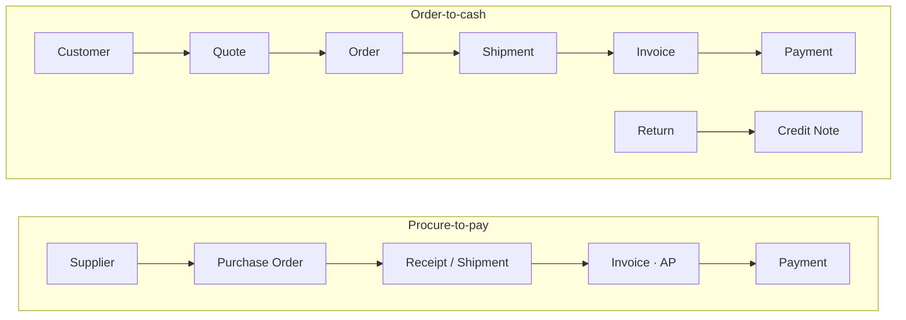
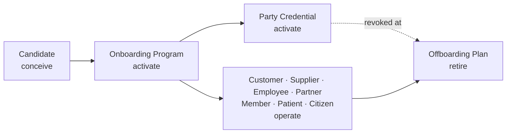
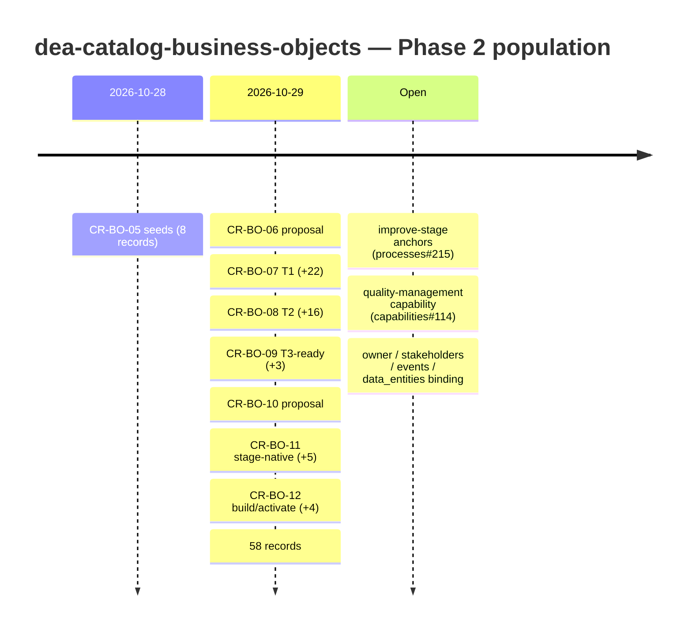

# OpenDEA Business Objects (dea-catalog-business-objects)

> Real-world entities of interest to the business — the atoms that populate the ECF matrix cells.

**Layer:** L2 · **Entity:** `BO` · **Metamodel:** [v1.0.0-alpha](https://github.com/technehub-labs/dea-metamodel)

[](https://technehub-labs.github.io/metamodel/?entity=BusinessObject)
[](https://github.com/technehub-labs/dea-catalog-business-objects/actions/workflows/ci.yml)
[](LICENSE)
[](entities/v1-alpha/README.md)
[](change-requests/README.md)

## What this catalog is

This repository is the canonical catalog of **Business Objects (BO)** for the TechNeHub Labs Digital Enterprise Architecture (DEA) ecosystem. A Business Object is a real-world entity the business cares about — a Customer, an Order, an Invoice — and it is the atom that populates the cells of the [ECF matrix](https://github.com/technehub-labs/dea-metamodel).

This is one of **seven interoperable catalogs** in the DEA ecosystem. Business Objects are acted on by capabilities, created and updated by processes, persisted by data entities, and realized by solution components — all expressed as typed, content-addressed, cross-catalog references.

## Status — Phase 2 population

From an 8-record seed ([CR-BO-05](change-requests/CR-BO-05-first-admission-seed-business-objects.md)) the catalog has grown to **58 Business Objects** across **9 classes**, **all 7 ECF domains**, and **6 of 7 ECF stages**, via five admission waves and two scope-setting proposals:

| Admission | CR | Records | Scope |
|---|---|---|---|
| Seeds | [CR-BO-05](change-requests/CR-BO-05-first-admission-seed-business-objects.md) | 8 | Order-to-cash core, instruments, controls |
| Wave-2 T1 | [CR-BO-07](change-requests/CR-BO-07-second-admission-wave2-t1.md) | 22 | Commercial-core extension ([CR-BO-06](change-requests/CR-BO-06-second-admission-wave-proposal.md) scope) |
| Wave-2 T2 | [CR-BO-08](change-requests/CR-BO-08-third-admission-wave2-t2.md) | 16 | Cross-industry, 8 sector lenses; `resource` + `location` classes |
| T3-ready | [CR-BO-09](change-requests/CR-BO-09-fourth-admission-t3-ready.md) | 3 | Goal, Forecast, Tax Record; first `strategy-direction` record |
| Stage-native | [CR-BO-11](change-requests/CR-BO-11-fifth-admission-stage-native.md) | 5 | First `conceive`/`design`/`retire` cells ([CR-BO-10](change-requests/CR-BO-10-ecf-stage-diversification-proposal.md) scope, BO-STG-01) |
| Stage-native II | [CR-BO-12](change-requests/CR-BO-12-sixth-admission-build-activate.md) | 4 | First `build`/`activate` cells |

| Level | Count |
| :--- | ---: |
| L1 (Business Object) | 58 |
| **Total** | **58** |

## Catalog at a glance

**Taxonomy** — 58 records across 9 `object_class` values ([source](docs/diagrams/catalog-taxonomy-mindmap.puml)):

![Catalog taxonomy mindmap](https://www.plantuml.com/plantuml/svg/NLLBhjiu4Dpx50IoSGmGy4UofG01OdsypG42uu6csZRpA5BXnubpW1mWbvdz76LECarIUdQoigLkDgkhgrgVh6F6zK9rFHi8Puv9VQ6E_T1Az_VPuikxTRrfy-MHl2mMUR5OaCfReS1Qyldq5RYpBxF5ukNBkzLXUwZMHp9WkJkP5-yn7oEBHuHxwtGF9htTP6NHL4TY_J180ORy-m-1Vf3w3X3-XpfgIiwRVTF6uaw0SY7EXHC_GOM_FVIdARF8wrLRucLCTQ9Z3cW4D69iYop3e3DCMSQTq8hCLwidg6E2PH8i_UQrYrZIepRTTCkwhUlT2lEkOkX7G0QSDugQdesOYsPRD8ZP6tvb5jBvM0xCJN2WJl1NS2FkTRlSxuzOvPiN1aBH5DXNRLLlZqGewn4s7kEIYJvIm0nGK5nxvLBbmP-au9JZTJ51UuCNMuYj9WwgNPalaNTzFeCHwaBcsqV_Kt3KWKVsZEuyTq-mKsQJxUjb4yPtijo88Ln01ydYG0OJsfF2ZZqSLdMsF1m9O2cMCes-61QxG57mL_eAC20QwfLm2MYPRLPhRFmi5BOjcAH8WJC-yZrVhH-efyoJa3BK4Egc4K1aODGSgk3-uBIkiiqcFvAlo8_2mXWmzv1-yjq5OhDdRG1f70-qzMwvtI0l1ZhXg1frSHO_eAFCsdG6NKFn5CvvQhlC2fnf9-mf3280eDXsqelKYQmE1csnAEDna146A3ZZAymNJavYG4wszIOh48U4orzyP0ywfYIkU-myCiSrTiZI654WeEmungBDidqGgSRNzwGP32BEjqQ2RxBYiDiToNTjNgbmq9FvxiaqOnHd6XP2cgb1wrrGYXVDP68sROsepV7SRfyNoOr2XRazYKAhasQcUtgRpcHvjIcRgDv7mgWwwn6vYuy9zdwPBPUukHpmgzAevtiYGii_H3-b6P0GV7e6Xax6NyakeIuB2ohfTfJFVdjOjIXdTHD6gsa1JBOMgDRkJMjjLHPP-wZ-jfYc9OUWK5LXr4mct7cpRNRnY4M1ef3dcmVQATWpvSyuKXzCJALEma47K7scFTOt8Z4_EZYuhcVyYbFuynQfKs_egITEgcfTbG62Oq9ID9616MVHvXz8INJS_I-uYb3yDboJ5oH9nYOLIMs2jDsLV2IiwuMruOxlx8RjO1gG_txzngNMeK7HU-41lqGNe0h1tE3zx1FW9obzbcR_0m00)

**ECF coverage** — records by domain and stage ([source](docs/diagrams/catalog-coverage.puml)):

![ECF coverage mindmap](https://www.plantuml.com/plantuml/svg/RLLBajis4Dth5AZAHbQLAiElAAzCKfJBoTXIPYQhbCe5WIqA2Gam8AYolF8XV9ViSvIS98sFFDBKR4I8UEZkz_2w-MxGLEcEYxgZFM5KqrOsSoPFe6W3azaVFuLbL2LtE_9vDaioKem35p0CPBF_4vWUPZEoFvEgN1C6RVjvCiCJIH6MwNf71gseXkOyhxb2B9U2JCCt247COXMLosn7c1GC-0d8Vz--ay3ipPvpb7I0MxZimSIyHh-NjBLfWtKQPAiTwP7GUQwWfIRbSEGzcGQNl66LfMNmUjwIYfhN6Dv1etYPhOeTeLZwwP8qTD2Ds4kgQYuQibMoKRGZ__v3jYOpAHNK83ItPHavLlcg2czhN_YCuw1b1yeSVXpxlkLkNNLzAyy0bw32lTuY8unibYNN_2i8i_m8tTxjbqZNx3y0awhsX0DKfTmH1HfluPhkvd1u9j5IuKGC5dcQe8XArYFJynDjHo3JpCiNL5aSBtUaXe4tuZhQ0_mzOe8Ey_l4MH6dqItjn66tBhXb3Uh46JW1zWDJlBT6CMoLsRZdWmF--hjzwB4-NpJtDMLf7XMlCNmSKG_zJ2vVhjO56XC4tRUsrBchplW4JRBmB9DibHedxKVUrhSaMq1FldHA5bPtUVx2dPxhHjNkSduRfNOyqP6TlyO7qADoR4V5ZYRsZmDFdFq55lMaWEhBaLAE2c6FlgFmpRtKFnTKiwFvKsm-MbDGTiGcSf99PHUvCHYZbsELE74bnINk1y5uxTThp3VYeNLB6qSnJefekNhH37TMrMMK146w8mSkA3RLd38cH_G_sceQH5xICa_NGVL2eiX9z46SfFV0bfulzRnNr2r-GSA2jbYlLcTBSQmR9unfDQx99wziFWpk_HePC-gCyqI_-8PmMb5BFdT5sd0WuC2z1iEe30bIjfHtbbvQXUKTph_6p4J74BwWAS70fh7dL-HnRb3N_6BVv18BfyxkzyWJFMcfIhmCoyUFEHGv3wC4VOIJLx3pNAg62lwLtaxEh8hZ_3LpFYdAnTL4Sl1baIoBzDN9YJWpmoUCsfvxInP47l2dbXr66aWl-n67A5ZXKhU7dui6hhUclCDPWOEq1s57oS3thNcYKaUfXZUJTxZXFp2J_m40)

**Value chains** — the order-to-cash spine and its inbound mirror:



**Party lifecycle** — stage-native objects bracket the operate-stage party roles:



**Governance timeline** — how the catalog grew, and its open threads:



## Catalog of Business Objects

All 58 records. Every record carries [README](entities/v1-alpha/README.md) + aspects documentation; sector lenses are labeled per the [CR-BO-06](change-requests/CR-BO-06-second-admission-wave-proposal.md) §6.3 explicit-lens convention; stage-native records per [BO-STG-01](change-requests/CR-BO-10-ecf-stage-diversification-proposal.md).

| Business Object | id | Class | ECF cell | Consumed by (capabilities) | Involved in (processes) | Sector lens |
|---|---|---|---|---|---|---|
| [Application](entities/v1-alpha/application-eewde8/README.md) | `objects:object-application-eewde8` | technology-control / application | enablement-operations · operate | technology-management, technology-enablement | eo-operate |  |
| [Asset](entities/v1-alpha/asset-w887xr/README.md) | `objects:object-asset-w887xr` | financial-instrument / fixed-asset | finance-accounting · operate | asset-management, financial-resource-management | eo-operate |  |
| [Benefit](entities/v1-alpha/benefit-entitlement-yx4ckm/README.md) | `objects:object-benefit-entitlement-yx4ckm` | financial-instrument / benefit-entitlement | finance-accounting · operate | financial-stewardship | fa-operate | *government* |
| [Bill of Material](entities/v1-alpha/bill-of-material-9skzte/README.md) | `objects:object-bill-of-material-9skzte` | resource / bill-of-material | enablement-operations · operate | operations-management | eo-operate | *manufacturing* |
| [Budget](entities/v1-alpha/budget-h77u8h/README.md) | `objects:object-budget-h77u8h` | financial-instrument / budget | finance-accounting · operate | financial-resource-management, financial-stewardship | fa-operate |  |
| [Business Case](entities/v1-alpha/business-case-et8p4e/README.md) | `objects:object-business-case-et8p4e` | work-item / business-case | strategy-direction · conceive | strategic-planning | sd-conceive |  |
| [Candidate](entities/v1-alpha/candidate-party-s8q2mk/README.md) | `objects:object-candidate-party-s8q2mk` | party / candidate-party | party-relationship · conceive | customer-management | pr-conceive |  |
| [Treatment](entities/v1-alpha/care-encounter-8enzdc/README.md) | `objects:object-care-encounter-8enzdc` | transaction / care-encounter | enablement-operations · operate | operations-management | eo-operate | *healthcare* |
| [Citizen](entities/v1-alpha/citizen-2xqsse/README.md) | `objects:object-citizen-2xqsse` | party / citizen | party-relationship · operate | customer-management | — | *government* |
| [Consent Record](entities/v1-alpha/consent-record-gacq7d/README.md) | `objects:object-consent-record-gacq7d` | legal-instrument / consent-record | party-relationship · operate | customer-management, information-management | — |  |
| [Contract](entities/v1-alpha/contract-w24y9z/README.md) | `objects:object-contract-w24y9z` | legal-instrument / commercial-contract | governance-existence · operate | legal-matter-management | — |  |
| [Course Section](entities/v1-alpha/course-section-j4fdpq/README.md) | `objects:object-course-section-j4fdpq` | transaction / course-section | enablement-operations · operate | operations-management | eo-operate | *education* |
| [Credit Note](entities/v1-alpha/credit-note-k6nktp/README.md) | `objects:object-credit-note-k6nktp` | financial-instrument / credit-note | finance-accounting · operate | financial-resource-management | fa-operate |  |
| [Customer](entities/v1-alpha/customer-2qvphc/README.md) | `objects:object-customer-2qvphc` | party / customer | party-relationship · operate | customer-management | pr-conceive, pr-operate |  |
| [Account](entities/v1-alpha/deposit-account-u6hdbe/README.md) | `objects:object-deposit-account-u6hdbe` | financial-instrument / deposit-account | finance-accounting · operate | financial-resource-management | fa-operate | *banking* |
| [Study Program](entities/v1-alpha/education-program-n6mp9m/README.md) | `objects:object-education-program-n6mp9m` | offering / education-program | product-value · operate | offering-management | pv-improve, pv-operate | *education* |
| [Employee](entities/v1-alpha/employee-phbzym/README.md) | `objects:object-employee-phbzym` | party / employee | party-relationship · operate | workforce-management | ao-operate, fa-operate |  |
| [Environment](entities/v1-alpha/environment-npd5vt/README.md) | `objects:object-environment-npd5vt` | technology-control / environment | enablement-operations · operate | technology-management, technology-enablement | eo-operate |  |
| [Feature Flag](entities/v1-alpha/feature-flag-p5gzf7/README.md) | `objects:object-feature-flag-p5gzf7` | technology-control / release-feature-flag | enablement-operations · operate | technology-enablement, technology-management | — |  |
| [Forecast](entities/v1-alpha/forecast-um3az3/README.md) | `objects:object-forecast-um3az3` | financial-instrument / forecast | finance-accounting · operate | financial-resource-management, enterprise-performance-management | fa-build, fa-operate |  |
| [Goal](entities/v1-alpha/goal-h2zfhv/README.md) | `objects:object-goal-h2zfhv` | work-item / strategic-goal | strategy-direction · operate | strategic-planning, enterprise-performance-management | sd-operate |  |
| [Grant](entities/v1-alpha/grant-nhdwg9/README.md) | `objects:object-grant-nhdwg9` | financial-instrument / disbursement-grant | finance-accounting · operate | financial-stewardship | — |  |
| [Incident](entities/v1-alpha/incident-wudf9s/README.md) | `objects:object-incident-wudf9s` | technology-control / service-incident | enablement-operations · operate | technology-management, continuity-management | eo-operate |  |
| [Insurance Claim](entities/v1-alpha/insurance-claim-g5mag3/README.md) | `objects:object-insurance-claim-g5mag3` | transaction / insurance-claim | finance-accounting · operate | financial-resource-management | fa-operate | *insurance* |
| [Invoice](entities/v1-alpha/invoice-z3fwgb/README.md) | `objects:object-invoice-z3fwgb` | financial-instrument / billing-invoice | finance-accounting · operate | financial-resource-management, financial-stewardship | — |  |
| [Journal Entry](entities/v1-alpha/journal-entry-khck7r/README.md) | `objects:object-journal-entry-khck7r` | financial-instrument / journal-entry | finance-accounting · operate | financial-resource-management | fa-operate |  |
| [License](entities/v1-alpha/license-na3j53/README.md) | `objects:object-license-na3j53` | legal-instrument / license | governance-existence · operate | legal-matter-management, regulation-management | — |  |
| [Loan](entities/v1-alpha/loan-byjy28/README.md) | `objects:object-loan-byjy28` | financial-instrument / loan | finance-accounting · operate | financial-resource-management, risk-management | fa-operate | *banking* |
| [Lot / Batch](entities/v1-alpha/manufacturing-lot-pkbqev/README.md) | `objects:object-manufacturing-lot-pkbqev` | resource / manufacturing-lot | enablement-operations · operate | operations-management | eo-operate | *manufacturing* |
| [Member](entities/v1-alpha/member-vbxqke/README.md) | `objects:object-member-vbxqke` | party / member | party-relationship · operate | customer-management | pr-improve | *non-profit* |
| [Offboarding Plan](entities/v1-alpha/offboarding-plan-djz4md/README.md) | `objects:object-offboarding-plan-djz4md` | work-item / offboarding-plan | party-relationship · retire | customer-management | pr-retire |  |
| [Onboarding Program](entities/v1-alpha/onboarding-program-mrun5r/README.md) | `objects:object-onboarding-program-mrun5r` | work-item / onboarding-program | party-relationship · activate | customer-management | pr-activate |  |
| [Order](entities/v1-alpha/order-bpy4g4/README.md) | `objects:object-order-bpy4g4` | transaction / sales-order | enablement-operations · operate | operations-management | eo-operate |  |
| [Partner](entities/v1-alpha/partner-cfhqx9/README.md) | `objects:object-partner-cfhqx9` | party / partner | party-relationship · operate | partner-management | — |  |
| [Party Credential](entities/v1-alpha/party-credential-kaqfq8/README.md) | `objects:object-party-credential-kaqfq8` | technology-control / party-credential | party-relationship · activate | security-management, information-management | pr-activate |  |
| [Patient](entities/v1-alpha/patient-w8ry62/README.md) | `objects:object-patient-w8ry62` | party / patient | party-relationship · operate | customer-management | eo-operate | *healthcare* |
| [Payment](entities/v1-alpha/payment-kgsvrg/README.md) | `objects:object-payment-kgsvrg` | financial-instrument / customer-payment | finance-accounting · operate | financial-resource-management | — |  |
| [Policy](entities/v1-alpha/policy-nd2t4y/README.md) | `objects:object-policy-nd2t4y` | legal-instrument / policy | governance-existence · operate | enterprise-governance, regulation-management | ge-operate |  |
| [Price List](entities/v1-alpha/price-list-4bk48j/README.md) | `objects:object-price-list-4bk48j` | offering / price-list | product-value · operate | offering-management, marketing | pv-operate |  |
| [Product](entities/v1-alpha/product-dkf9gb/README.md) | `objects:object-product-dkf9gb` | offering / catalogue-product | product-value · operate | offering-management, marketing | pv-design, pv-operate |  |
| [Machine](entities/v1-alpha/production-machine-j5z9kv/README.md) | `objects:object-production-machine-j5z9kv` | resource / production-machine | enablement-operations · operate | asset-management, operations-management | eo-operate | *manufacturing* |
| [Project](entities/v1-alpha/project-5hgzd3/README.md) | `objects:object-project-5hgzd3` | work-item / project | agency-organization · operate | enterprise-performance-management, strategic-planning | sd-operate |  |
| [Case](entities/v1-alpha/public-case-ae4yg8/README.md) | `objects:object-public-case-ae4yg8` | transaction / public-case | governance-existence · operate | legal-matter-management | ge-operate | *government* |
| [Purchase Order](entities/v1-alpha/purchase-order-qf4tfa/README.md) | `objects:object-purchase-order-qf4tfa` | transaction / purchase-order | enablement-operations · operate | sourcing-and-procurement | eo-operate, fa-operate |  |
| [Quote](entities/v1-alpha/quote-gnngfe/README.md) | `objects:object-quote-gnngfe` | transaction / sales-quote | enablement-operations · operate | operations-management | eo-operate |  |
| [Release Candidate](entities/v1-alpha/release-candidate-wed4tk/README.md) | `objects:object-release-candidate-wed4tk` | technology-control / release-candidate | enablement-operations · build | technology-management, technology-enablement | eo-build |  |
| [Requirement](entities/v1-alpha/requirement-9ukadu/README.md) | `objects:object-requirement-9ukadu` | transaction / requirement | product-value · design | offering-management, technology-management | pv-design |  |
| [Store](entities/v1-alpha/retail-store-6kzkfj/README.md) | `objects:object-retail-store-6kzkfj` | location / retail-store | enablement-operations · operate | operations-management, facility-management | eo-operate | *retail* |
| [Return](entities/v1-alpha/return-uwz79t/README.md) | `objects:object-return-uwz79t` | transaction / return-rma | enablement-operations · operate | operations-management | eo-operate |  |
| [Service](entities/v1-alpha/service-q8w4ce/README.md) | `objects:object-service-q8w4ce` | offering / service | product-value · operate | offering-management | pv-operate |  |
| [Shipment](entities/v1-alpha/shipment-mb7wgn/README.md) | `objects:object-shipment-mb7wgn` | transaction / shipment | enablement-operations · operate | operations-management | eo-operate |  |
| [SKU](entities/v1-alpha/stock-keeping-unit-x6rq8r/README.md) | `objects:object-stock-keeping-unit-x6rq8r` | offering / stock-keeping-unit | product-value · operate | offering-management, operations-management | eo-operate, pv-operate | *retail* |
| [Subscription](entities/v1-alpha/subscription-3v98yb/README.md) | `objects:object-subscription-3v98yb` | offering / subscription-plan | product-value · operate | offering-management | pv-operate |  |
| [Sunset Plan](entities/v1-alpha/sunset-plan-34225t/README.md) | `objects:object-sunset-plan-34225t` | work-item / sunset-plan | product-value · retire | offering-management | pv-retire |  |
| [Supplier](entities/v1-alpha/supplier-g7m7fu/README.md) | `objects:object-supplier-g7m7fu` | party / supplier | party-relationship · operate | supplier-management, sourcing-and-procurement | eo-operate, fa-operate |  |
| [Tax Record](entities/v1-alpha/tax-record-zwqfpa/README.md) | `objects:object-tax-record-zwqfpa` | financial-instrument / tax-record | finance-accounting · operate | financial-resource-management, regulation-management | fa-design, fa-operate |  |
| [Ticket](entities/v1-alpha/ticket-2cudww/README.md) | `objects:object-ticket-2cudww` | transaction / service-ticket | enablement-operations · operate | operations-management | eo-operate |  |
| [Training Program](entities/v1-alpha/training-program-r8fpt3/README.md) | `objects:object-training-program-r8fpt3` | work-item / training-program | agency-organization · build | workforce-management, workforce-planning | ao-build |  |

## Entity Definition

| Field | Value |
|-------|-------|
| Entity ID | `dea:entity-business-object` |
| Class Alias | `BO` |
| Layer | L2 (Business Operating Model) |
| Metamodel Version | v1.0.0-alpha |

## Classification

Business Objects are classified by **two universal coordinates plus two free-form labels**:

### Universal coordinates (ECF matrix position)

| Axis | Values |
|---|---|
| `ecf_domain` | `governance-existence` · `strategy-direction` · `agency-organization` · `party-relationship` · `product-value` · `enablement-operations` · `finance-accounting` |
| `ecf_stage` | `conceive` · `design` · `build` · `activate` · `operate` · `improve` · `retire` |

Every BO lives in exactly one `(ecf_domain, ecf_stage)` cell at a time.

### Free-form labels (domain-specific vocabulary)

| Axis | Purpose | Example |
|---|---|---|
| `object_class` | Kind of thing the business cares about | `customer`, `order`, `product`, `invoice`, `feature-flag`, `grant` |
| `object_subclass` | Refinement under the class | `retail-customer`, `enterprise-order` |

`current_state` is a **separate** domain-specific business label (e.g. `active`, `proposed`, `suspended`) — distinct from the universal `ecf_stage` coordinate.

### Classes in use today

| `object_class` | Records | Subclasses |
|---|---|---|
| `party` | 8 | `customer`, `supplier`, `employee`, `partner`, `patient`, `citizen`, `member`, `candidate-party` |
| `transaction` | 11 | `sales-order`, `sales-quote`, `shipment`, `return-rma`, `purchase-order`, `service-ticket`, `insurance-claim`, `care-encounter`, `public-case`, `course-section`, `requirement` |
| `offering` | 6 | `catalogue-product`, `service`, `subscription-plan`, `price-list`, `education-program`, `stock-keeping-unit` |
| `financial-instrument` | 12 | `billing-invoice`, `customer-payment`, `disbursement-grant`, `journal-entry`, `budget`, `credit-note`, `fixed-asset`, `loan`, `deposit-account`, `benefit-entitlement`, `forecast`, `tax-record` |
| `legal-instrument` | 4 | `commercial-contract`, `license`, `policy`, `consent-record` |
| `technology-control` | 6 | `release-feature-flag`, `application`, `environment`, `service-incident`, `release-candidate`, `party-credential` |
| `work-item` | 7 | `project`, `strategic-goal`, `business-case`, `offboarding-plan`, `sunset-plan`, `training-program`, `onboarding-program` |
| `resource` | 3 | `manufacturing-lot`, `bill-of-material`, `production-machine` |
| `location` | 1 | `retail-store` |

Industry and segment variation is expressed at the subclass level (rule BO-TAX-01, [CR-BO-06](change-requests/CR-BO-06-second-admission-wave-proposal.md)); new `object_class` values require CR-level sign-off. Aspects prose carries an explicit sector lens (CR-BO-06 §6.3).


| Field | Value |
|-------|-------|
| Entity ID | `dea:entity-business-object` |
| Class Alias | `BO` |
| Layer | L2 (Business Operating Model) |
| Metamodel Version | v1.0.0-alpha |


## Typed References

| Field | Reference | Catalog | Status |
|---|---|---|---|
| `owner` | Actor (single) | [`dea-catalog-actors`](https://github.com/technehub-labs/dea-catalog-actors) | Scaffold (unset on seeds — IDM-003 forbids unresolved references) |
| `stakeholders[]` | External/affected parties | [`dea-catalog-stakeholders`](https://github.com/technehub-labs/dea-catalog-stakeholders) | Scaffold (unset on seeds) |
| `capabilities_consumed[]` | Capabilities that act on this BO | [`dea-catalog-business-capabilities`](https://github.com/technehub-labs/dea-catalog-business-capabilities) | Populated (28 canonical records) |
| `processes_involved[]` | Processes that create/read/update/delete this BO | [`dea-catalog-business-processes`](https://github.com/technehub-labs/dea-catalog-business-processes) | Populated (3,598 records) |
| `data_entities[]` | Data entities persisting this BO | (TBD) | Unbound |
| `components_realizing[]` | Solution Components that realize this BO | [`dea-catalog-digital-business-service-factory`](https://github.com/technehub-labs/dea-catalog-digital-business-service-factory) | Scaffold |
| `events[]` | Business events this BO participates in | (TBD) | Unbound |

Every reference was resolved against the live sibling catalogs before landing; deliberately unset fields remain empty until their catalogs bind, per IDM-003.


## Identity

Records are **content-addressed**: the id hash suffix was assigned once, at admission, from the record content (first 4 bytes of the file's SHA-256, base-31 over the alphabet `a-z` minus `i`, `l`, `o` plus digits `2-9`) and is immutable thereafter. The filesystem path is the id with `:` normalized to `-` (IDM-005).

```yaml
id: objects:object-customer-2qvphc      # namespace:level-slug-hash6
identity:                              # instance-level identity (planned)
  primary_id: customer-12345            # canonical handle
  external_ids:                         # source-system mapping
    crm_id: SF-0034Q00012
    erp_id: SAP-DEBI-9001
```

See [`dea-metaframework/docs/id-system.md`](https://github.com/technehub-labs/dea-metaframework/blob/main/docs/id-system.md) §2.5 for the org-wide id contract.

## Catalog Structure

```
dea-catalog-business-objects/
├── CATALOG.yaml                        ← auto-generated catalog index (do not hand-edit)
├── metamodel-pointer.yaml              ← entity mapping (do not edit manually)
├── README.md
├── LICENSE + NOTICE
├── CHANGELOG.md · CONTRIBUTING.md
├── entities/
│   └── v1-alpha/                       ← catalog entries (flat layout)
│       ├── README.md                   ← entry-level topology, gates, workflow
│       └── object-<slug>-<hash6>/
│           ├── objects-object-<slug>-<hash6>.yaml
│           └── README.md               ← per-record documentation (IDM-007)
├── schemas/
│   └── entity.schema.json              ← mirrors dea-metamodel/schemas/entities/business-object.json
├── catalog-index-schema/
│   └── catalog-index-schema.json       ← schema for CATALOG.yaml
├── change-requests/                   ← CR-BO-01..05 governance trail
├── reconciliation/                     ← authorship registry, entity-system registry
├── docs/
│   └── governance/cardinal-rules.md
├── scripts/                            ← conformance validators (IDM, ES, AUT, catalog)
├── tests/                              ← validator unit tests
└── .github/workflows/                  ← CI: validate, conformance, allocation, authorship, entity-system
```


## Quality Gates

Every PR runs the full conformance pipeline (see [`entities/v1-alpha/README.md`](entities/v1-alpha/README.md) for the complete list):

- **Schema validation** — every record against `schemas/entity.schema.json`
- **CST suite (16 tests)** — id-pattern conformance, content-derived hash correctness, flat-layout invariants
- **ID System Gate (IDM-001..008)** — id drift detection between branches and the canonical baseline
- **Authorship Gate** — cardinal rules R1/R2, data-driven from `reconciliation/authorship-fields.yaml`
- **CR Metadata Gate** — every structural change tied to an approved Change Request
- **Allocation & register gates** — orphan/duplicate record detection, catalog-register honesty


## Contributing

Admissions go through the CR workflow described in [`entities/v1-alpha/README.md`](entities/v1-alpha/README.md) and [`CONTRIBUTING.md`](CONTRIBUTING.md).

## Diagrams

The PlantUML sources for the embedded mindmaps live in [`docs/diagrams/`](docs/diagrams/); the README embeds their `plantuml.com` server-rendered SVG URLs (re-encode after editing a source, per the format used by the `plantuml` reference encoder).
